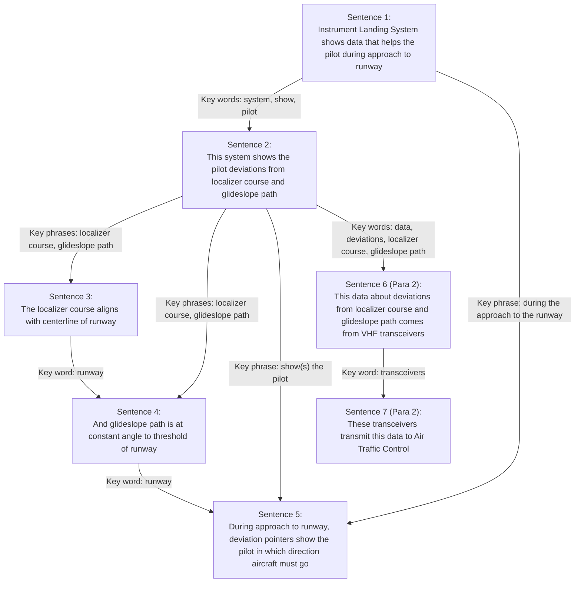

# Section 6: Descriptive Writing (Rules 6.1–6.6)

**Standard Reference:** ASD-STE100, Issue 9 (2025-01-15)  
**Part 1 — Writing Rules:** Section 6 (Descriptive Writing, Rules 6.1–6.6)

---

## 1. Overview and Scope

Descriptive writing provides technical explanations, descriptions of systems, components, functions, theory of operation, and general technical information (such as reports, specifications, and papers). It also includes notes in procedures.

Unlike procedural writing ([Section 5: Procedural Writing](procedures.md)), descriptive writing **gives information, not instructions**. Therefore, **the imperative form of the verb is not permitted in descriptive text** (refer to [Rule 5.3](procedures.md#4-rule-53-imperative-form-for-instructions)).

Section 6 establishes six interrelated rules (Rules 6.1 through 6.6) designed to manage cognitive complexity, maintain thematic discipline, ensure consistent lexical cohesion, and prevent reader overload:
- **Rule 6.1:** Give information gradually. Present one subject at a time.
- **Rule 6.2:** Build logical cohesion with stable key words and connecting phrases. Avoid synonym rotation.
- **Rule 6.3:** Keep descriptive sentences to a maximum of 25 words (counted by Section 8 rules).
- **Rule 6.4:** Group related information into structured paragraphs initiated by clear topic sentences.
- **Rule 6.5:** Restrict each paragraph to exactly one topic.
- **Rule 6.6:** Restrict each paragraph to a maximum of six grammatical sentences.

---

## 2. Rule 6.1: Presenting Information Gradually

> **Rule 6.1:** Give information gradually.

### 2.1 Principles and Rationale
Technical descriptions frequently describe interconnected multi-variable systems (e.g., avionics, hydraulics, software architectures). If an author introduces too many new concepts, actors, or relationships simultaneously in a single sentence or compressed passage, the reader is overwhelmed and must re-read the text multiple times to untangle dependencies.

In STE descriptive writing:
- Present information step-by-step in logical order.
- Ensure that each sentence contains **only one primary subject** (grammatical subject/topic).
- Unpack dense compound-complex sentences into progressive conceptual steps.

### 2.2 Source Analysis: Instrument Landing System (ILS)

The standard presents an authentic before-and-after case demonstrating how dense prose is untangled into gradual, single-subject sentences (Rule 6.1):

#### Non-STE Baseline (Dense, Rapid Conceptual Jumps)
> *Instrument Landing System*  
> During the approach to the runway, deviation pointers in the course indicators give commands to fly up or down and left or right. This information comes from the VHF transceivers, which are part of the Instrument Landing System. This helps the pilot during the landing approach. When the pilot responds to the commands, the aircraft can be flown over the runway centerline (localizer) and at a fixed angle (glideslope) to the runway threshold. The localizer signals are processed by the transceiver and data are transmitted to Air Traffic Control.

*Flaws in Non-STE:*
- The text jumps erratically between pointer movements, VHF transceiver origins, pilot benefits, aircraft flight paths, and air traffic control data transmission.
- Subjects shift mid-stride: "deviation pointers" → "this information" → "this" → "the aircraft" → "localizer signals".
- Contains passive constructions ("can be flown", "are processed", "are transmitted").

#### STE Conforming Rewrite (Gradual Presentation)
> *Instrument Landing System*  
> The Instrument Landing System (the system) on the aircraft shows data that helps the pilot during the approach to the runway. This system shows the pilot the deviations from the localizer course and the glideslope path. The localizer course aligns with the centerline of the runway. And the glideslope path is at a constant angle to the threshold of the runway. During the approach to the runway, deviation pointers in the course indicators show the pilot in which direction the aircraft must go:  
>  - Left or right (for the localizer)  
>  - Up or down (for the glideslope).  
> This data about deviations from the localizer course and glideslope path comes from two VHF transceivers. These transceivers transmit this data to Air Traffic Control.

*Analysis of Gradual Flow:*
1. **Sentence 1 (System overview):** Subject is `The Instrument Landing System`. Establishes the core function: showing data to help the pilot during approach.
2. **Sentence 2 (Component variables):** Subject is `This system`. Introduces the two key components: the localizer course and glideslope path.
3. **Sentence 3 (Localizer definition):** Subject is `The localizer course`. Explains alignment with runway centerline.
4. **Sentence 4 (Glideslope definition):** Subject is `the glideslope path`. Explains the constant angle to the runway threshold.
5. **Sentence 5 (Indicator display):** Subject is `deviation pointers in the course indicators`. Maps directions (left/right vs up/down) directly to localizer and glideslope.
6. **Sentence 6 (Data origin):** Subject is `This data about deviations...`. Connects data to two VHF transceivers.
7. **Sentence 7 (External transmission):** Subject is `These transceivers`. Explains data transmission to Air Traffic Control.

---

## 3. Rule 6.2: Logical Cohesion and Stable Key Words

> **Rule 6.2:** Use key words and key phrases to give your text a logical structure.

### 3.1 Lexical Stability vs. Synonym Rotation
In creative writing, authors rotate synonyms to create stylistic variety. In technical writing, **synonym rotation is dangerous**. If a writer refers to a component as an "exciter unit", then a "spark generator", and later an "ignition box", a non-native reader, technician, or automated translation engine will assume these are three distinct parts.

ASD-STE100 requires **strict lexical stability**:
- Choose one approved noun or technical name for each concept, component, or condition.
- Maintain that exact term throughout the passage and document.
- Use repeated key words to anchor the reader as new information is linked to known information (the "known-to-new" principle).

### 3.2 Connecting Words and Phrases as "Traffic Signs"
Approved connecting words and phrases signal logical relationships between sentences:
- **Addition:** `and`
- **Contrast / Exception:** `but`
- **Sequence / Consequence:** `then`, `thus`, `as a result`
- **Simultaneity / Concurrency:** `at the same time`

### 3.3 Textual Architecture: Sentence-by-Sentence Linkages
The standard traces exact lexical repetitions across sentences in the ILS text (Rule 6.2):



- **Sentences 1 → 2:** Reuses `system`, `show`, and `pilot` to add specific detail to the general statement.
- **Sentences 2 → 3 & 4:** Unpacks `localizer course` and `glideslope path`.
- **Sentences 3 & 4 → 5:** Connects via `runway` and refers back to Sentence 1 via `during the approach to the runway`.
- **Paragraph 1 → Paragraph 2:** Paragraph 2 opens by synthesizing the key words established in Paragraph 1: `This data about deviations from the localizer course and glideslope path...`.

---

## 4. Rule 6.3: Maximum Sentence Length in Descriptions

> **Rule 6.3:** Write short sentences. Use a maximum of 25 words in each sentence.

### 4.1 Rationale for the 25-Word Threshold
Descriptive sentences describe complex physical systems, scientific relationships, and operational principles. To accommodate necessary relative clauses and prepositional qualifiers, STE grants a ceiling of **25 words** for descriptive sentences (compared to 20 words for procedures).

### 4.2 Independence of Formatting and Line Wrapping
The 25-word limit applies to the **grammatical sentence**, measured from its initial capital letter to its concluding full stop (or colon before a vertical list). 
- Physical line wrapping, column breaks, software formatting, and responsive screen widths have **no effect** on sentence word count.
- Counting must follow Section 8 special rules (refer to [Section 8: Punctuation and Word Count](punctuation-and-counting.md#7-rule-86-the-seven-special-counting-groups-1-word-each)).

### 4.3 Example: Breaking Over-Long Descriptive Sentences
The following example demonstrates breaking an over-long descriptive sentence into two conforming sentences:

- **Non-STE (31 words):**  
  `A smartphone is a cellular telephone that has an integrated computer and many other functions, such as an operating system, internet browsing as well as the ability to run software applications.`
- **STE Conforming Revision (15 words + 16 words):**  
  `A smartphone is a cellular telephone that has an integrated computer and many other functions.` (15 words)  
  `It includes an operating system and an internet browser, and it can also operate software applications.` (16 words)

*Analysis:* The original definition combines core identity, computer features, operating system, web browsing, and application execution into a sprawling 31-word structure. Splitting it cleanly establishes identity in Sentence 1 (15 words) and details capabilities in Sentence 2 (16 words).

---

## 5. Rule 6.4: Paragraph Structure and Topic Sentences

> **Rule 6.4:** Use paragraphs to show related information.

### 5.1 The Function of Paragraphs
In procedural text, numbered steps establish temporal sequence. In descriptive text, **paragraphs group logically related information** and guide the reader through concepts.

In STE:
- Every paragraph must begin with an explicit **topic sentence**.
- The topic sentence announces the subject of the paragraph.
- Subsequent sentences in the paragraph develop, explain, substantiate, or qualify that topic sentence.

### 5.2 Example: Aircraft Lightning Strike

The standard illustrates a three-paragraph descriptive section with clear topic sentences and lists:

```markdown
1. Lightning Strike
A. General
(1) A lightning strike can cause damage to the aircraft. The damage usually occurs at the attachment points. The attachment points include:
    - The nose of the fuselage
    - The tail section
    - The propellers
    - The wing tips
    - The tips of the stabilizer
    - The trailing edge of the stabilizer
    - The antennas
    - The static dischargers.
(2) From the attachment points, the lightning strike usually goes aft through the structure of the aircraft. The high current of the lightning strike can cause damage to the mechanical systems of the aircraft. Thus, a permanent or a temporary malfunction of the electrical and electronic equipment and systems can occur.
(3) If a lightning strike occurs, it is necessary to do an inspection of the aircraft for damage. The maintenance personnel must do this inspection before the next flight.
```

*Paragraph Structural Breakdown:*
1. **Paragraph (1) — Topic Sentence:** `A lightning strike can cause damage to the aircraft.` Focuses strictly on physical damage and locations (attachment points).
2. **Paragraph (2) — Topic Sentence:** `From the attachment points, the lightning strike usually goes aft through the structure of the aircraft.` Explains the path of current and resulting secondary electrical/mechanical failures.
3. **Paragraph (3) — Topic Sentence:** `If a lightning strike occurs, it is necessary to do an inspection of the aircraft for damage.` Focuses strictly on maintenance inspection obligations.

---

## 6. Rule 6.5: One Topic per Paragraph

> **Rule 6.5:** Make sure that each paragraph has only one topic.

### 6.1 Unified Topical Focus
A paragraph must not drift from its primary subject. If a paragraph begins by describing hydraulic fluid properties, it must not introduce pump overhaul procedures or reservoir maintenance intervals midway through.

### 6.2 The "Outline Test"
A reliable test for Rule 6.5 compliance is the **Outline Test**:
- Extract the first sentence (topic sentence) from every paragraph in the section.
- Read them in sequence.
- **Result:** The extracted topic sentences should form a coherent, complete high-level outline of the entire document. If any topic sentence fails to summarize its paragraph, or if a paragraph introduces secondary topics not covered by its topic sentence, Rule 6.5 is violated.

---

## 7. Rule 6.6: Maximum Six Sentences per Paragraph

> **Rule 6.6:** Make sure that no paragraph has more than six sentences.

### 7.1 The Six-Sentence Boundary
To ensure technical documents remain digestible and avoid impenetrable "walls of text", STE imposes a strict limit: **no descriptive paragraph may contain more than six grammatical sentences**.
- If a descriptive topic requires more than six sentences, divide the material into two or more distinct sub-topics and create separate paragraphs, each with its own topic sentence.

### 7.2 Distinguishing Grammatical Sentences from Vertical List Items
It is essential to distinguish between a **grammatical sentence** (for Rule 6.6 paragraph limits) and a **word-count unit** (for Rule 8.4 word limits):
- A vertical list preceded by a lead-in sentence ending in a colon often constitutes **one single grammatical sentence**.
- For Rule 8.4 (word count), the lead-in sentence and each vertical list item receive independent word count budgets (max 25 words each in descriptions).
- However, for Rule 6.6 (paragraph sentence limit), a standard vertical list that completes a single introductory clause counts as **one grammatical sentence**, not ten separate sentences.

### 7.3 Complete Case Study: Fuel Manifold Description

The standard provides an exhaustive example demonstrating six consecutive conforming paragraphs in a technical component description:

#### Paragraph 1 (1 Grammatical Sentence)
> `The fuel manifold (1) has these primary parts:`  
> `- Two motorized fuel shut-off valves (referred to in this manual as a "shut-off valve")`  
> `- A pressure transducer (2)`  
> `- Three fittings (10), (13) and (15).`  
*(1 grammatical sentence, compliant with Rule 6.6).*

#### Paragraph 2 (2 Grammatical Sentences)
> `The shut-off valve operates in the valve body (21). The valve body (21) has:`  
> `- An aluminum alloy ball (27)`  
> `- A retaining ring (31)`  
> `- Two seals (26)`  
> `- A spring (25).`  
*(2 grammatical sentences, compliant with Rule 6.6).*

#### Paragraph 3 (5 Grammatical Sentences)
> `[1] The spring (25) holds the ball (27) in position to prevent internal leakage.`  
> `[2] The preformed packings (18), (2) and (30) are installed on the seals (26), the shaft (28), and in the valve body.`  
> `[3] They prevent external leakage.`  
> `[4] One of the two seals (26), on which the spring (25) operates, has the function of a relief valve.`  
> `[5] It operates when the pressure applied in the opposite direction is more than a set value.`  
*(5 grammatical sentences, compliant with Rule 6.6).*

#### Paragraph 4 (5 Grammatical Sentences)
> `[1] The actuator assembly (4) is of a rotary type.`  
> `[2] A DC motor, which has a permanent high-speed magnet, supplies power to the actuator.`  
> `[3] Micro-switches in the actuator de-energize it at the end of travel.`  
> `[4] They also send signals to the fuel control panel to show the operation condition of the valve.`  
> `[5] A micro-relay controls the direction of shaft rotation and an electrical connector connects the actuator assembly to the aircraft electrical supply.`  
*(5 grammatical sentences, compliant with Rule 6.6).*

#### Paragraph 5 (4 Grammatical Sentences)
> `[1] The pressure transducer (2) is installed downstream of the shut-off valve (in the RH engine line).`  
> `[2] The fitting (10) connects the pressure transducer (2) to the fuel manifold (1).`  
> `[3] A lockwire safeties the pressure transducer (2).`  
> `[4] The pressure transducer (2) has an electrical connector that connects it to the Fuel Management System of the aircraft.`  
*(4 grammatical sentences, compliant with Rule 6.6).*

#### Paragraph 6 (2 Grammatical Sentences)
> `[1] Three fittings (10), (13), and (15) connect the two shut-off valves and the pressure transducer (2).`  
> `[2] They attach the fuel manifold (1) to the aircraft structure.`  
*(2 grammatical sentences, compliant with Rule 6.6).*

---

## 8. Descriptive Writing Summary Checklist

| Rule | Requirement | Verification Question |
|---|---|---|
| **6.1** | Give information gradually | Does each sentence present only one primary subject? Are complex relationships unpacked step-by-step? |
| **6.2** | Stable key words & logical structure | Are technical nouns consistent throughout (no synonym rotation)? Are approved connecting words ("and", "but", "then", "thus") used effectively? |
| **6.3** | Max 25 words per sentence | Is every descriptive sentence $\le$ 25 words using [Section 8 counting rules](punctuation-and-counting.md#7-rule-86-the-seven-special-counting-groups-1-word-each)? |
| **6.4** | Structured paragraphs with topic sentences | Does every paragraph open with a clear topic sentence that introduces its content? |
| **6.5** | One topic per paragraph | Does each paragraph pass the Outline Test? Is there zero topical drift? |
| **6.6** | Max 6 sentences per paragraph | Does any paragraph contain more than 6 grammatical sentences? Are vertical lists correctly accounted for? |
