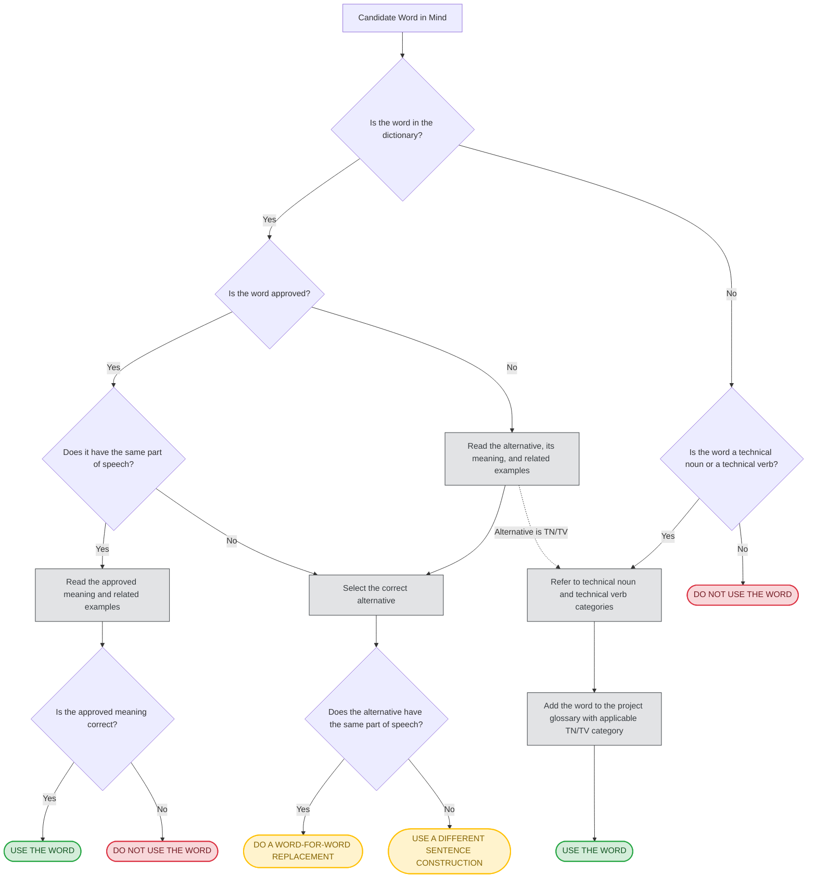

# Part 2: Dictionary Guide and Consultation Protocols

> **Governing Document**: ASD-STE100 Simplified Technical English, Issue 9 (2025-01-15)  
> **Source Location**: Part 2 – Dictionary, Introduction (Pages 2-0-3 through 2-0-20)  
> **Repository Architecture**: Bundled, Self-Contained Lexical Shards under `dictionary/` (Zero External PDF Dependencies)  
> **Scope**: Normative Layout, 4 Columns, 8 Parts of Speech, Morphology, 4 Help Classes, STEMG Flowchart, Recurring Errors, and Agent Consultation Protocols

---

## 1. Overview and Dictionary Architecture

The ASD-STE100 dictionary is not a general English dictionary. It is a **controlled lexical specification** designed to enforce two foundational principles of unambiguous technical writing:
1. **One Word, One Meaning (Rule 1.3)**: Each approved word is restricted to exactly one approved technical concept or definition. Metaphorical, colloquial, or extended meanings are strictly prohibited.
2. **One Word, One Part of Speech (Rule 1.2)**: Functional shift (conversion) is prohibited. A word approved as a noun cannot be used as a verb (`check (v)` and `test (v)` are non-STE), and adjectives cannot serve as verbs.

### 1.1 Lexical Inventory of Issue 9
As officially established in Part 2 of ASD-STE100 Issue 9:
- **875 Approved Words**: Core keywords authorized for use in technical descriptions and procedural instructions.
- **1,274 Unapproved Guide Words**: High-frequency non-STE words provided with approved alternatives and contextual demonstration sentences.
- **208 Approved Verbs**: Strictly controlled action verbs authorized for maintenance and operational prose.
- **Technical Terminology Framework**: The dictionary intentionally does *not* list all domain-specific Technical Nouns (TN) or Technical Verbs (TV), but frequently cross-references them as approved alternatives marked `(TN)` or `(TV)` (governed by Rules 1.5 and 1.12).

### 1.2 Bundled Lexical Reference System
To ensure complete portability, speed, and deterministic behavior
across automated AI agents and developer workflows, a lexical
reference of 1,956 entries is bundled directly within this skill
repository under [`dictionary/`](dictionary/index.md):
- **Alphabetical Shards**: 20 modular markdown files covering letters
  A through Z ([`a.md`](dictionary/a.md), [`b.md`](dictionary/b.md),
  [`c.md`](dictionary/c.md), etc.). Letter X has no entries.
- **Approved Verbs Directory**: Tabular quick-reference of all 208 approved verbs ([`approved-verbs.md`](dictionary/approved-verbs.md)).
- **Recurring Errors Catalog**: Full catalog of the 39 most frequent non-STE errors with replacement strategies ([`recurring-errors.md`](dictionary/recurring-errors.md)).
- **Zero External Dependencies**: Lookups execute directly against local markdown files without requiring external PDF files, page coordinate calculations, or third-party extraction tools.

---

## 2. The Four-Column Dictionary Layout

The ASD-STE100 dictionary is structured as a standardized four-column specification:

```
+--------------------+-------------------------+-------------------------+-------------------------+
| Column 1           | Column 2                | Column 3                | Column 4                |
| Word               | Approved meaning /      | STE EXAMPLE             | Non-STE example         |
| (part of speech)   | ALTERNATIVES            |                         |                         |
+--------------------+-------------------------+-------------------------+-------------------------+
```

### 2.1 Column 1: Word (Part of Speech)
- **Typeface and Capitalization**:
  - **UPPERCASE BOLD** = **Approved Word** in STE (e.g., **`ABRASIVE (adj)`**, **`AID (n)`**, **`CLEAN (v)`**). Authors and agents may use this word within its approved grammatical role and meaning.
  - **lowercase bold** = **Unapproved Word** in STE (e.g., **`abandon (v)`**, **`main (adj)`**, **`rotate (v)`**). Authors are strictly prohibited from using this word unless it qualifies as an authorized Technical Noun or Technical Verb.
- **Part of Speech Tag**: Specified in parentheses immediately after the headword: `(n)`, `(v)`, `(adj)`, `(adv)`, `(pron)`, `(art)`, `(prep)`, `(conj)`.
- **Morphological Inflections**: For verbs and adjectives, permitted inflected forms are printed directly below or alongside the headword (e.g., `ADAPT (v), ADAPTS, ADAPTED, ADAPTED`).

### 2.2 Column 2: Approved Meaning / ALTERNATIVES
- **For Approved Words (Capitalized Headword)**:
  - Gives the **official approved meaning (definition)** in standard English.
  - *Critical Rule*: The text of dictionary definitions is **not** written in STE. It is an editorial definition to explain the concept.
  - *Restriction*: If a desired meaning is not explicitly listed in Column 2, the word **cannot** be used in that sense. Authors must select a different approved word.
- **For Unapproved Words (Lowercase Headword)**:
  - Gives **approved alternatives** printed in **UPPERCASE BOLD**.
  - Alternatives are suggestions to help the author. They may require either a direct word-for-word replacement or a full sentence reconstruction.
  - Alternatives may possess a different part of speech than the unapproved headword.
  - When an alternative is a domain-specific technical term, it is tagged **`(TN)`** or **`(TV)`**.
  - When an alternative is a multi-word phrase, it is printed without a part-of-speech tag (e.g., **`AT THE SAME TIME`** for `simultaneously`).

### 2.3 Column 3: STE EXAMPLE
- Illustrates correct usage of the approved word or approved alternative in compliant technical prose.
- Printed entirely in **UPPERCASE LETTERS** (e.g., `POLISH THE SURFACE WITH AN ABRASIVE PAPER.`).
- Serves as an approved model sentence demonstrating compliant syntax, word order, and context.

### 2.4 Column 4: Non-STE Example
- Illustrates how the unapproved word or non-compliant construction is typically used in standard English.
- Printed in *lowercase or mixed-case italics* with the non-conforming words highlighted.
- **For Approved Words**: Column 4 is empty, **except** when Help Category 2 applies (showing unapproved senses of the approved word, e.g., `ABOUT (prep)` or `WEAR (v)`).

---

## 3. The Eight Parts of Speech in ASD-STE100

ASD-STE100 recognizes exactly eight grammatical parts of speech:

| # | Part of Speech | Tag | Definition & Role in STE | Operational Constraints & Examples |
|:---:|:---|:---:|:---|:---|
| 1 | **Noun** | `(n)` | Name of a person, place, object, idea, quality, or activity. | Listed in singular form. Plural of countable nouns is permitted unless Help restricts. *Example*: `AGENT (n)`. |
| 2 | **Verb** | `(v)` | Word expressing a state of being or an action. | Permitted only in listed tenses (present, past, future) and imperative mood. Divided into 4 verb classes. *Example*: `ADAPT (v)`. |
| 3 | **Adjective** | `(adj)` | Word modifying a noun, noun phrase, or multi-word noun (type, size, color, quantity). | Positioned before nouns or after `be`. Listed in base form with irregular comparative/superlative in parentheses. *Example*: `SLOW (adj)`. |
| 4 | **Adverb** | `(adv)` | Word modifying a verb, adjective, or another adverb (how, where, when, how often, how much). | Often formed by adding `-ly` to an approved adjective. Comparative/superlative formed with `MORE` and `MOST`. *Example*: `SLOWLY (adv)`. |
| 5 | **Pronoun** | `(pron)` | Word replacing a noun, noun phrase, or multi-word noun. | Strictly controlled. Referents must be 100% unambiguous. *Example*: `IT (pron)`, `YOU (pron)`. |
| 6 | **Article** | `(art)` | Function word indicating whether a noun is indefinite (`a`, `an`) or definite (`the`). | Mandatory before countable nouns. Omission in clipped telegram style is prohibited. *Example*: `A (art)`, `THE (art)`. |
| 7 | **Preposition** | `(prep)` | Function word showing spatial, temporal, or logical relations. | Approved only in specific literal relationships. Many common prepositions have restricted senses. *Example*: `BEHIND (prep)`. |
| 8 | **Conjunction** | `(conj)` | Word or phrase connecting words, phrases, and clauses. | Used to build clear compound structures without exceeding sentence word caps. *Example*: `BECAUSE (conj)`, `BUT (conj)`. |

---

## 4. Morphology & Word Form Paradigms

Part 2 establishes rigorous morphological rules governing permitted inflections:

### 4.1 Four Verb Classes
Issue 9 formally categorizes all verbs into four distinct morphological classes:

1. **Regular Verbs**: Follow the predictable `-ed` pattern for simple past and past participle.
   - Listed as: `BASE, 3RD-PERSON-SINGULAR-PRESENT, SIMPLE PAST, PAST PARTICIPLE`
   - *Example*: `ADAPT (v), ADAPTS, ADAPTED, ADAPTED`
   - *Constraint*: Do not use a past participle form if it is not explicitly listed in the dictionary entry!

2. **Irregular Verbs**: Do not follow standard `-ed` formation.
   - Listed with all authorized irregular forms.
   - *Example*: `GIVE (v), GIVES, GAVE, GIVEN`
   - *Example*: `BREAK (v), BREAKS, BROKE, BROKEN`

3. **Irregular Auxiliary Verbs**:
   - The verb `BE (v)` has irregular present and past forms:  
     `BE (v), IS, WAS (also ARE, WERE). No other verb forms.`
   - Forms such as `being` or `been` are **strictly prohibited** because progressive tenses and compound passives are non-compliant.

4. **Defective Modal Verbs**: Verbs in which certain standard forms are completely absent.
   - **`CAN (v)`**: Listed as `CAN, COULD. No other verb forms.` Meaning: to be possible, able to, or permitted to. (Subject to Help: do not use `could` for possibility!).
   - **`CANNOT (v)`**: Auxiliary modal verb meaning not to be able to.
   - **`WILL (v)`**: Listed as `No other verb forms.` Auxiliary modal verb indicating simple future tense.
   - **`MUST (v)`**: Auxiliary modal verb that shows obligation. Base form only.

### 4.2 Adjective Inflections
- Listed in base form.
- Short adjectives that take `-er` and `-est` have their inflections listed in parentheses:  
  `SLOW (adj) (SLOWER, SLOWEST)`  
  `DEEP (adj) (DEEPER, DEEPEST)`
- Long adjectives that form comparatives and superlatives using `more` and `most` do **not** list those forms in Column 1, because **`MORE (adv)`** and **`MOST (adv)`** are independently approved adverbs in Issue 9.

### 4.3 Adverb Formation
- Frequently formed by attaching `-ly` to an approved adjective.
- Comparative and superlative forms are created using `MORE` and `MOST` (e.g., `MORE SLOWLY`).

### 4.4 Past Participles as Adjectives (Rule 3.3)
- A past participle may serve as an adjective after `BE` or before a noun **only** if the dictionary lists the past participle form or it satisfies the criteria of Rule 3.3.
- An adjectival state after `be` must not be confused with a passive voice construction:
  - *Compliant Adjective State*: `THE VALVE IS CLOSED.` (Describes the static condition of the valve).
  - *Prohibited Passive Action*: `THE VALVE WAS CLOSED BY THE OPERATOR.` (Describes an event; must be active: `THE OPERATOR CLOSED THE VALVE.`).

---

## 5. The Four Help Classes (Light Bulb Symbol)

In the dictionary, the light bulb graphic symbol ("Help") marks special semantic and operational constraints. Help is divided into **four specific functional categories**:

```
+--------------------------------------------------------------------------+
|                         FOUR CLASSES OF HELP                             |
+--------------------+-----------------------------------------------------+
| Category 1         | Operational Recommendations:                        |
|                    | How to use the approved word correctly with         |
|                    | required adverbs or prepositions.                   |
+--------------------+-----------------------------------------------------+
| Category 2         | Restricted Meanings:                                |
|                    | Approved word has a narrow meaning; use approved    |
|                    | alternatives for all other senses.                  |
+--------------------+-----------------------------------------------------+
| Category 3         | Context-Specific Approvals:                         |
|                    | Word is approved ONLY in one specific technical     |
|                    | context (e.g., safety instructions only).           |
+--------------------+-----------------------------------------------------+
| Category 4         | Important Notices & Grammatical Peculiarities:      |
|                    | Advisories on redundancy, missing forms, or         |
|                    | structural alternatives.                            |
+--------------------+-----------------------------------------------------+
```

### 5.1 Category 1: Usage Recommendations for Approved Words
Gives specific syntactic instructions on how to combine the approved word with other elements:
- **`PUSH (v)`**:
  - Meaning 2: "To move with a force against something."
  - *Help 1 Notice*: *"Use this word together with a preposition or an adverb to show direction."*
  - *STE Example*: `THE SPRING UNIT PUSHES AGAINST THE BRAKE PEDAL.`

### 5.2 Category 2: Restricted Meanings (Mandatory Alternatives for Other Senses)
Alerts the author that an approved word has only **one specific approved sense**, and provides mandatory alternatives for all secondary meanings:
- **`ABOUT (prep)`**:
  - Approved Meaning: *"Concerned with"* (`FOR DATA ABOUT THE LOCATION OF CIRCUIT BREAKERS, REFER TO THE WIRING LIST.`).
  - *Help 2 Notice*: *"For other meanings, use:"*
    - For numerical approximations: **`APPROXIMATELY (adv)`** (`DRAIN APPROXIMATELY 2 LITERS OF FUEL FROM THE TANK.`).
    - For circular motion/location: **`AROUND (prep)`** (`TURN THE SHAFT AROUND ITS AXIS.`).
- **`ABOVE (prep)`**:
  - Approved Meaning: *"In (or to) a position farther up than something"* (spatial).
  - *Help 2 Notice*: *"For other meanings, use:"*
    - For quantities/values exceeding a limit: **`MORE THAN`** (`THE PRESSURE VALUE MUST BE MORE THAN 800 kPa.`).
- **`WEAR (v)`**:
  - Approved Meaning: *"To become damaged by friction"* (`THE CABLE CAN WEAR QUICKLY IN THIS POSITION.`).
  - *Help 2 Notice*: *"For other meanings, use:"*
    - For equipment/shields: **`USE (v)`** (`USE A PROTECTIVE SHIELD.`).
    - For protective clothing: **`PUT ON (v)`** (`PUT ON PROTECTIVE CLOTHING.`).

### 5.3 Category 3: Single-Context Approvals
Restricts an approved word strictly to a single technical or operational environment:
- **`SWALLOW (v)`**:
  - Approved Meaning: *"To take through the mouth and esophagus into the stomach."*
  - *Help 3 Notice*: *"Use this word for safety instructions only."*
  - *STE Example*: `IF YOU SWALLOW NITRIC ACID, DO NOT CAUSE VOMITING. GET MEDICAL AID IMMEDIATELY.`
  - *Prohibition*: Cannot be used in descriptive or procedural contexts (an engine ingesting debris cannot "swallow" birds). Use `INGEST (TV)` or `ENTER (v)` instead.

### 5.4 Category 4: Important Notices & Clarifications
Provides critical linguistic advice regarding unapproved words or grammatical quirks:
- **`already (adv)`**:
  - Unapproved word with alternatives `IN PROGRESS (adv)` or `NO OTHER`.
  - *Help 4 Notice*: *"Frequently, an alternative for this word is not necessary."*
  - *STE Example*: `MAKE SURE THAT THE SOFTWARE IS INSTALLED IN THE REPOSITORY.` (Simply omit `already`).
- **`BE (v)`**:
  - Explicit warning that forms other than `IS, WAS, ARE, WERE` do not exist in STE.

---

## 6. Word Selection Decision Flowchart

The official STEMG decision flowchart governs all word selections:



---

## 7. Official List of Recurring Errors

The STEMG provides a dedicated catalog of the **most frequent lexical errors** committed by technical writers. Consult [`dictionary/recurring-errors.md`](dictionary/recurring-errors.md) for the complete 39-word deep dive.

Key recurring traps:
- `check (v)` -> **`CHECK (n)`**, **`MAKE SURE (v)`**, **`EXAMINE (v)`**, **`MEASURE (v)`**
- `test (v)` -> **`TEST (n)`**, **`DO (v)`**
- `ensure (v)` -> **`MAKE SURE (v)`**
- `shall (v)` / `should (v)` -> **`MUST (v)`**
- `fit (v)` / `secure (v)` -> **`INSTALL (v)`**, **`ATTACH (v)`**, **`SAFETY (v)`**
- `using (v)` -> **`USE (v)`**, **`WITH (prep)`**

---

## 8. Official List of Approved Verbs

ASD-STE100 Issue 9 authorizes exactly **208 approved action verbs**. If an action verb is not in this directory, it cannot be used unless it qualifies as an authorized Technical Verb under Rule 1.12. Consult [`dictionary/approved-verbs.md`](dictionary/approved-verbs.md) for the complete reference table.

---

## 9. Historical Critical Pitfall Words & Clarifications

Source inspection resolves nine critical traps that frequently confuse authors and automated tools:

### 9.1 `WEAR (v)`
- **Approved Meaning**: *"To become damaged by friction"* (`THE CABLE CAN WEAR QUICKLY IN THIS POSITION.`).
- **Clothing / PPE Trap**: `WEAR` is **prohibited** for putting on or wearing protective gear.
  - For shields/tools: use **`USE (v)`** (`USE A PROTECTIVE SHIELD.`).
  - For clothing/goggles: use **`PUT ON (v)`** (`PUT ON PROTECTIVE CLOTHING.`).

### 9.2 `PREVIOUSLY (adv)` & `PREVIOUS (adj)`
- **`PREVIOUSLY (adv)`**: Newly approved in Issue 9! Approved Meaning: *"Before, earlier, in the past"* (`THIS SOFTWARE FINDS TERMS FROM PREVIOUSLY TRANSLATED FILES.`).
- **`PREVIOUS (adj)` vs `LAST (adj)`**: Approved Meaning of `PREVIOUS`: *"That goes before in an unspecified time or sequence"*. Help Category 2 explicitly mandates:
  > *"Be accurate. Use LAST (adj) for the event that occurs immediately before in time or sequence."*
  - Non-STE: *Do the previous inspection again.*
  - STE: `DO THE LAST INSPECTION AGAIN.`

### 9.3 `AS ... AS (conj)`
- **Approved Status**: Approved conjunction for comparison/relation (`MOVE THE LEVER AS FAST AS POSSIBLE.`).
- **Duration Trap**: Prohibited for duration or conditions (`as long as`). Help explicitly mandates cross-reference to `long (as long as)` -> use `WHILE (conj)`.

### 9.4 `ABOUT (prep)`
- **Approved Meaning**: *"Concerned with"* (`DATA ABOUT THE LOCATION OF CIRCUIT BREAKERS...`).
- **Approximation Trap**: Prohibited for numerical values. Use **`APPROXIMATELY (adv)`** (`APPROXIMATELY 2 LITERS`).
- **Spatial Trap**: Prohibited for rotation or encircling. Use **`AROUND (prep)`** (`AROUND ITS AXIS`).

### 9.5 `SWALLOW (v)`
- **Approved Meaning**: *"To take through the mouth and esophagus into the stomach."*
- **Safety Restriction**: Governed by Category 3 Help: *"Use this word for safety instructions only."* (`IF YOU SWALLOW NITRIC ACID...`). Prohibited in general mechanical descriptions.

### 9.6 `CAN (v)` vs `COULD`
- **Approved Forms**: `CAN, COULD. No other verb forms.`
- **Meaning**: Auxiliary modal verb meaning to be possible, able to, or permitted to.
- **Possibility Trap**: Help Category 1 explicitly commands:
  > *"Do not use COULD (v) to show possibility."*
  - Non-STE: *If you do not obey this warning, an explosion could occur.*
  - STE: `IF YOU DO NOT OBEY THIS WARNING, AN EXPLOSION CAN OCCUR.`

### 9.7 `PUT ON (v)`
- **Forms**: `PUT ON, PUTS ON, PUT ON. No other verb forms.`
- **Approved Meaning**: *"To cover your skin or face with clothing, or other items that give protection."* (`PUT ON SAFETY GOGGLES AND PROTECTIVE CLOTHING.`).
- **Phrasal Restriction**: One of the very few authorized phrasal verbs in STE. Permitted *only* for protective clothing/gear.

### 9.8 `CHECK (n)` vs `check (v)`
- **`CHECK (n)`**: Approved noun meaning *"The procedure you do to make sure that something operates correctly or has no defects"* (`DO A CHECK OF THE HYDRAULIC SYSTEM.`).
- **`check (v)`**: Unapproved verb. Must be replaced by `MAKE SURE THAT...`, `EXAMINE`, `MEASURE`, or `DO A CHECK OF...`.

### 9.9 `CAREFULLY (adv)`
- **Approved Status**: Fully approved adverb meaning *"In a careful manner"* (`CAREFULLY APPLY A BEAD OF SEALING COMPOUND.`).
- Often mischaracterized as unapproved by outdated tools. Verified approved in Issue 9 Part 2.

---

## 10. The Five-Step Agent Dictionary Reading Procedure

Whenever an authoring agent or human technical writer must evaluate a candidate word in technical text, follow this deterministic five-step protocol against the bundled shards:

```
[ Step 1: Context & POS ] ──► Identify word and grammatical role in context
                                  │
[ Step 2: Lexical Lookup] ──► Locate entry in bundled dictionary (dictionary/index.md);
                              check approval status (UPPERCASE vs lowercase)
                                  │
[ Step 3: Help & Forms ]  ──► Read definitions, permitted inflections,
                              and Help boxes (Categories 1–4)
                                  │
[ Step 4: Alternatives ]  ──► If unapproved: evaluate TN/TV categories or select
                              approved alternative (direct swap vs reconstruction)
                                  │
[ Step 5: Fidelity Check] ──► Verify that candidate word preserves technical meaning
                              without introducing ambiguity or changing obligation
```

1. **Step 1: Identify Word and Part of Speech in Context**:
   Determine the exact grammatical function of the word in the sentence (noun, verb, adjective, adverb, preposition, conjunction).
2. **Step 2: Locate Entry in Bundled Dictionary**:
   Using [`dictionary/index.md`](dictionary/index.md), navigate to the corresponding alphabetical shard. Check whether the word is printed in bold UPPERCASE (approved) or bold lowercase (unapproved).
3. **Step 3: Inspect Approved Meaning and Help Boxes**:
   Verify that your intended sense matches the definition in Column 2. Check Column 1 for permitted inflections. Inspect Help symbols to verify no Category 2 (restricted sense) or Category 3 (context restriction) violations occur.
4. **Step 4: Resolve Unapproved Words**:
   If the word is unapproved, verify whether it qualifies as a Technical Noun (Rule 1.5) or Technical Verb (Rule 1.12). If not, evaluate the Column 2 approved alternatives and determine whether a word-for-word replacement or whole-sentence reconstruction is required.
5. **Step 5: Semantic Fidelity Verification**:
   Re-read the completed sentence in its surrounding paragraph. Confirm that technical meaning, safety tolerances, actor responsibilities, and procedural sequence are strictly preserved without distortion.
