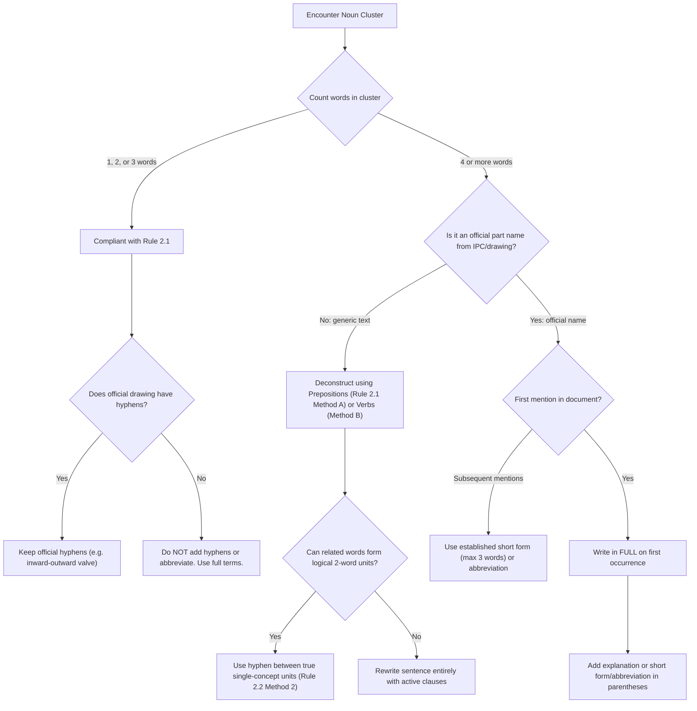

# Section 2: Multi-Word Nouns (Rules 2.1 – 2.2)

> **Rule Specification**: ASD-STE100 Issue 9, Part 1 – Writing Rules, Section 2: Multi-Word Nouns (Rules 2.1 through 2.2).

---

## Executive Summary & The Problem of Noun Stacking

In English, nouns frequently function as adjectives (noun adjuncts) to modify other nouns. In specialized engineering, writers routinely stack multiple nouns and adjectives together into extensive noun clusters, such as:

$$\text{"Runway"} + \text{"light"} + \text{"connection"} + \text{"resistance"} + \text{"calibration"}$$

While native English speakers may unconsciously infer the semantic hierarchy, **multi-word noun stacking is the single greatest cause of ambiguity and comprehension failure for non-native readers**.

### Linguistic Breakdown of Modifier Confusion
1. **Head Noun Position**: In English syntax, the head noun (the primary object or action being discussed) is almost invariably the **last word** in the cluster.
2. **Cross-Linguistic Interference**: In Romance languages (French, Spanish, Italian, Portuguese) and several Asian languages, the head noun comes **first**, followed by qualifying modifiers. A non-native reader encountering *Runway light connection resistance calibration* must hold four modifying concepts in working memory before discovering that the sentence is discussing a *calibration*.
3. **Ambiguous Associative Branching**: In a 5-word noun phrase $N_1 - N_2 - N_3 - N_4 - N_5$, multiple branching trees are linguistically possible:
   - Is it the *calibration* of $[(\text{runway light connection}) \text{ resistance}]$?
   - Or is it the $[(\text{runway light}) (\text{connection resistance})] \text{ calibration}$?
   - Is a *high-temperature pressure sensor harness* a harness for a sensor under high temperature, or a sensor measuring high-temperature pressure?

Section 2 resolves this ambiguity by establishing strict length boundaries and systematic structural transformations.

---

## Rule 2.1: The Three-Word Cluster Limit

> **Rule Statement**:  
> **Write multi-word nouns of no more than three words.**

### Rationale & Cognitive Capacity
Working memory studies show that syntactic parsing accuracy degrades exponentially when more than two noun modifiers precede a head noun. Restricting multi-word nouns to a maximum of **three words** ensures that relationship paths between words remain immediately obvious.

### Word-Count Anatomy

```
[ Modifier 1 ]   +   [ Modifier 2 ]   +   [ Head Noun ]   =   3 Words (COMPLIANT)
   Actuator             operating             rod

[ Mod 1 ]  +  [ Mod 2 ]  +  [ Mod 3 ]  +  [ Mod 4 ]  +  [ Head Noun ] = 5 Words (NON-STE)
 Runway        light       connection    resistance       calibration
```

### Methods for Deconstructing Long Noun Clusters

#### Method A: Prepositional Disassembly
Break the modifier chain by introducing clarifying prepositions (`of`, `for`, `on`, `in`, `with`).

- *Non-STE (5 words)*:  
  *Runway light connection resistance calibration.*
- **STE Transformation (1 word, 1 word, 3 words)**:  
  `CALIBRATION OF THE RESISTANCE OF THE RUNWAY LIGHT CONNECTION.`

- *Non-STE (6 words)*:  
  *Install the forward turbine overheat thermocouple terminal tags.*
- **STE Transformation (2 words and 3 words)**:  
  `INSTALL THE TERMINAL TAGS ON THE FORWARD OVERHEAT THERMOCOUPLE OF THE TURBINE.`

#### Method B: Verbal Restructuring (Transforming Noun Phrases into Active Clauses)
De-nominalize action-nouns embedded in clusters (such as *attachment*, *alignment*, *operation*) and express them as active finite verbs or relative clauses.

- *Non-STE (5 words)*:  
  *Remove the engine transmission housing attachment bolts.*
- **STE Transformation (1 word, 1 word, 2 words, 1 word)**:  
  `REMOVE THE BOLTS THAT ATTACH THE TRANSMISSION HOUSING TO THE ENGINE.`
  - *Analysis*: The noun *attachment* is converted to the active verb `ATTACH`, clarifying that the bolts attach the housing to the engine.

- *Non-STE (4 words)*:  
  *Adjust to obtain door operating rod alignment with the attachment point.*
- **STE Transformation (3 words and 1 word)**:  
  `ADJUST THE DOOR OPERATING ROD UNTIL IT ALIGNS WITH THE ATTACHMENT POINT.`
  - *Analysis*: The nominal phrase *obtain alignment* is transformed into the active subordinate clause `until it aligns with`.

---

## Rule 2.2: Long Official Technical Names (4+ Words)

> **Rule Statement**:  
> **When a technical noun has more than three words, write it in full.**  
> **Then, you can use one of these methods to make the technical noun clear:**  
> - **Give a shorter form of the technical noun.**  
> - **Use hyphens (-) between words that you use as one unit.**

### The Engineering Reality
Technical writers do not operate in a vacuum. Equipment manufacturers, illustrated parts catalogs (IPCs), and engineering drawings frequently assign official nomenclature exceeding three words (e.g., *Ramp Service Door Safety Connector Pin*). Writers cannot unilaterally alter baseline drawings or rename certified parts on first mention. Rule 2.2 provides two standardized pathways for handling these official designations.

---

### Method 1: Shorter Form & Abbreviation Protocol

When an official technical noun exceeding three words is introduced:
1. Write the official technical name **in full upon its first occurrence**.
2. Define its accepted short form or abbreviation immediately in parentheses.
3. Use the shorter form or approved abbreviation consistently throughout the remainder of the document.

#### Protocol 1A: Defined Shorter Technical Form
- **STE Example**:  
  `BEFORE YOU DO THIS PROCEDURE, ENGAGE THE RAMP SERVICE DOOR SAFETY CONNECTOR PIN (THE PIN THAT HOLDS THE RAMP SERVICE DOOR, REFERRED TO IN THIS PROCEDURE AS THE "SAFETY CONNECTOR PIN").`
- **Subsequent References**:  
  Use `SAFETY CONNECTOR PIN` (3 words: compliant with Rule 2.1).

#### Protocol 1B: Defined Acronyms / Abbreviations
When an official entity has a recognized acronym in company documentation, introduce it in full on first mention:

- **STE Contextual Model**:  
  `THE MAIN FUEL METERING UNIT (MFMU) IS AN ALUMINUM ALLOY UNIT THAT INCLUDES A MAIN ENGINE CONTROL UNIT (MECU) AND A DISTRIBUTION BLOCK (DB). THE MFMU IS INSTALLED IN THE ENGINE BYPASS DUCT AND OPERATES IN THE ENGINE FUEL SYSTEM. THE FUNCTION OF THE MFMU IS TO METER AND SUPPLY THE FUEL FROM THE MAIN ENGINE FUEL PUMP (MEFP) TO THE FUEL MANIFOLDS AND THE STARTER JETS. THE DIGITAL ENGINE CONTROL UNIT (DECU) SENDS ELECTRICAL SIGNALS TO OPERATE THE MFMU.`

---

### Strict Safeguards Against Abbreviation Abuse

> [!CAUTION]
> **Prohibition Against Abbreviating Short Terms (≤ 3 Words)**:  
> If an approved technical noun contains **three words or less**, you must **never** replace it with an abbreviation. Abbreviations create cognitive barriers and increase error rates.

#### Example: Parts Lists & Procedural Steps

```
NON-STE (Abbreviation Abuse):
The primary parts of the valve are:
- The DA (8)
- The PVA (15)
- The BA (17)
- The VB (20).

STE (Fully Spelled-Out Technical Nouns):
THE PRIMARY PARTS OF THE VALVE ARE:
- THE DIAPHRAGM ASSEMBLY (8)
- THE POPPET VALVE ASSEMBLY (15)
- THE BUSH ASSEMBLY (17)
- THE VALVE BODY (20).
```

```
NON-STE (Procedural Cryptic Abbreviation):
A. Remove the DA (8) from the VB (20).
B. Remove the PVA (15) from its seat.
C. Remove the BA (17) from the VB (20).

STE (Clear, Explicit Procedural Terminology):
A. REMOVE THE DIAPHRAGM ASSEMBLY (8) FROM THE VALVE BODY (20).
B. REMOVE THE POPPET VALVE ASSEMBLY (15) FROM ITS SEAT.
C. REMOVE THE BUSH ASSEMBLY (17) FROM THE VALVE BODY (20).
```

---

### Method 2: Hyphenation (`-`) Between Words Acting as One Unit

A hyphen is an approved punctuation mark that binds two or more words into a single semantic and grammatical unit. Under ASD-STE100 word-counting rules:

$$\mathbf{1\text{ Hyphenated Unit} = 1\text{ Word}}$$

#### Legitimate Unit Hyphenation
- `cutoff-switch power connection` $\rightarrow$ 3 words (`cutoff-switch` [1] + `power` [2] + `connection` [3]).
- `lavatory rapid-decompression device` $\rightarrow$ 3 words (`lavatory` [1] + `rapid-decompression` [2] + `device` [3]).

---

### Strict Safeguards Against Hyphen Abuse

> [!WARNING]
> **Prohibition Against Arbitrary Hyphenation (Cheating the Word Count)**:  
> Hyphenating words simply to evade Rule 2.1 is strictly forbidden. Chaining 4 or 5 words together with hyphens creates illegible monstrosities that violate the core clarity principles of STE.

#### Illegitimate vs. Legitimate Multi-Word Hyphenation
- *Non-STE (Arbitrary Chain)*:  
  *Move the main-gear-door-retraction-winch handle.*  
  *(Counting as 2 words via artificial hyphen stacking, but strictly non-compliant).*
- **STE (Correct Semantic Grouping)**:  
  `MOVE THE MAIN-GEAR-DOOR RETRACTION-WINCH HANDLE.`  
  *(3 words: `main-gear-door` [1] + `retraction-winch` [2] + `handle` [3]).*

#### Prohibition Against Unnecessary Hyphenation of Short Names
If an approved technical noun contains three words or less, **do not add hyphens**:
- *Non-STE*: *Remove the diaphragm-assembly (8) from the valve body (20).*
- **STE**: `REMOVE THE DIAPHRAGM ASSEMBLY (8) FROM THE VALVE BODY (20).`
- *Non-STE*: *Remove the poppet-valve assembly (15) from its seat.*
- **STE**: `REMOVE THE POPPET VALVE ASSEMBLY (15) FROM ITS SEAT.`

#### Preservation of Mandatory Official Hyphens
If an approved technical noun already contains an official hyphen in engineering documentation (e.g., *inward-outward valve*), **never remove the hyphen**:
- *Non-STE*: *The inward outward valve is part of the fuel system.*
- **STE**: `THE INWARD-OUTWARD VALVE IS PART OF THE FUEL SYSTEM.`

---

## Decision Flowchart: Processing Multi-Word Nouns



---

## Detailed Transformation Catalog

| Source Non-STE Construction | Word Count | Defect Analysis | Compliant STE Construction | Resulting Word Structure |
| :--- | :---: | :--- | :--- | :--- |
| *High pressure fuel shutoff valve assembly* | 6 | 5 modifiers before head noun *assembly*. | `SHUTOFF VALVE ASSEMBLY FOR THE HIGH-PRESSURE FUEL SYSTEM` | 3 words + prep + 3 words |
| *Main rotor blade trim tab actuator rod* | 7 | Extreme cognitive stack. | `ACTUATOR ROD FOR THE TRIM TAB OF THE MAIN ROTOR BLADE` | 2 words + prep + 2 words + prep + 3 words |
| *Emergency battery charging circuit test procedure* | 6 | Excessive noun cluster (5 modifiers). | `PROCEDURE TO DO A TEST OF THE EMERGENCY BATTERY CHARGING CIRCUIT` | Restructured with approved core verb DO and approved noun TEST (Rule 1.2) |
| *Low speed wind tunnel test data analysis* | 7 | Multiple functional layers. | `ANALYSIS OF TEST DATA FROM THE LOW-SPEED WIND TUNNEL` | 1 word + prep + 2 words + prep + 3 words |
| *Flight control surface position indicator switch* | 6 | Ambiguous modifier relations. | `SWITCH FOR THE INDICATOR OF THE FLIGHT CONTROL SURFACE POSITION` | Disassembled into discrete, unambiguous segments |
| *Engine turbine exhaust gas temperature sensor* | 6 | Heavy modifier accumulation. | `SENSOR FOR THE EXHAUST GAS TEMPERATURE OF THE ENGINE TURBINE` | Disassembled with prepositional architecture |

---

## Cross-Reference Matrix

- **[words.md](words.md)**: Rule 1.2 (Part of Speech), Rule 1.5 (Technical Noun Categories), Rule 1.8 (Official Industry Terminology), Rule 1.9 (Short Technical Nouns).
- **[sentences.md](sentences.md)**: Rule 4.1 (Short and Clear Sentences), Rule 4.5 (Articles and Demonstrative Adjectives).
- **[terminology.md](terminology.md)**: TN-01 (Official Parts Information), TN-06 (Systems and Components), Hyphenation Governance.
- **[dictionary/index.md](dictionary/index.md)**: Lexical lookups and part-of-speech verification.
