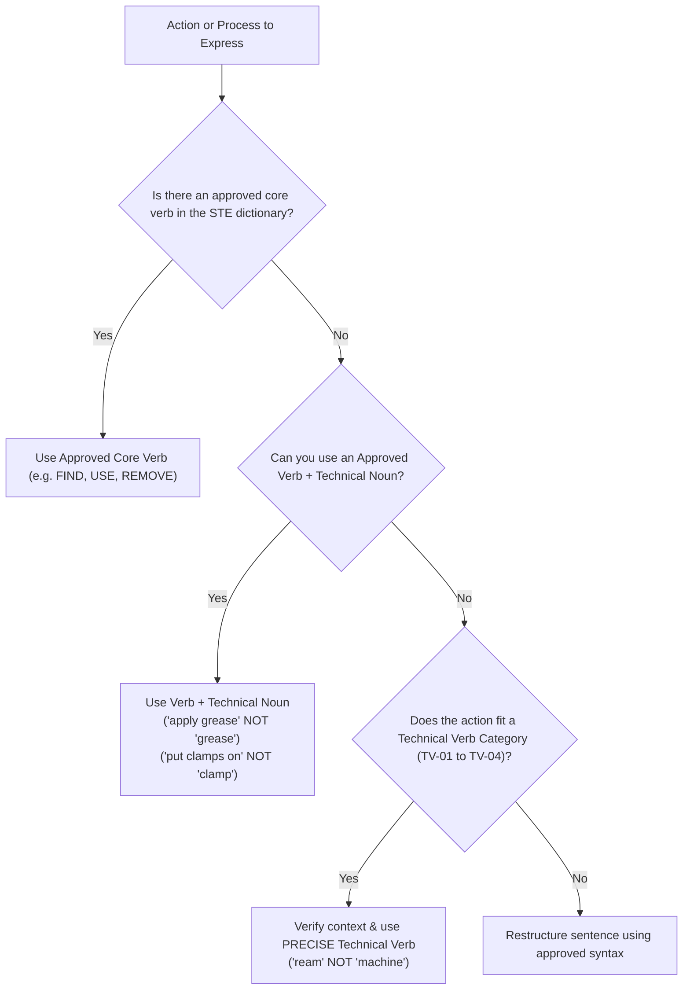

# Terminology Reference: Technical Nouns & Technical Verbs

> **Rule Specification**: ASD-STE100 Issue 9, Part 1 – Writing Rules, Section 1: Words (Rules 1.5–1.13: Technical Nouns and Technical Verbs).

---

## Executive Summary & Terminology Governance

Simplified Technical English (STE) maintains an intentionally lean core dictionary (875 approved words). However, real-world engineering, aerospace, defense, and high-tech maintenance require millions of specialized designations. To accommodate this without compromising clarity or control, ASD-STE100 provides a rigorous, standardized taxonomy:

1. **22 Technical-Noun Categories (TN-01 through TN-22)**: Standardized functional domains permitting technical substantives.
2. **4 Technical-Verb Categories (TV-01 through TV-04)**: Standardized process domains permitting specialized operational verbs.

### Governance Principles (ISO 1087:2019 Alignment)
- **Subject Field Definition**: Under ISO 1087:2019, a "subject field" is a domain or sphere of knowledge with specialized terminology.
- **Enterprise Terminology Database**: Every organization adopting STE must establish and maintain an official terminology database or company glossary. Any word not found in the STE dictionary must be officially validated against one of these 26 categories before technical authors incorporate it into operational documentation.
- **Contextual Necessity**: Technical words are permitted when defined in the domain or project, but approved core words take precedence whenever they can accurately convey the meaning.

---

## Part I: The 22 Technical-Noun Categories (TN-01 – TN-22)

Technical nouns can be used in both **procedural** and **descriptive** text. Unless designated as proper nouns, official document titles, or acronyms, technical nouns are written in lowercase in standard sentences.

---

### TN-01: Official Parts Information

- **Scope & Definition**: Terms that refer to all physical design items, parts, and hardware assemblies. These terms originate in engineering drawings, Illustrated Parts Catalogs (IPC), Component Maintenance Manuals (CMM), and Bills of Materials (BOM).
- **Contextual Conditions**: Must represent tangible components specified in the design baseline. Avoid colloquial shop floor nicknames.
- **Official Examples from Issue 9**:
  `bolt`, `cable`, `clip`, `conductor`, `contact`, `engine`, `ferry tank`, `filter`, `hatch`, `hazard lights`, `indicator`, `light`, `logo`, `oil seal`, `prelubricated seal`, `pipe`, `propeller`, `retractor link`, `screw`, `switch`, `transceiver`.
- **Special Application Notes**: Where parts have callout numbers or index references on illustrations, simplify long names down to the head noun (e.g., `the four screws (10)`, `the flange (15)`; see [words.md#rule-19-short-and-clear-technical-names](words.md#rule-19-short-and-clear-technical-names)).

---

### TN-02: Vehicles or Machines, and Locations on Them

- **Scope & Definition**: Terms that refer to complete operational transport units, vehicles, industrial machines, and the physical zones, compartments, and structural stations located upon them.
- **Contextual Conditions**: Encompasses aerospace, naval, automotive, railway, and heavy industrial plant configurations.
- **Official Examples from Issue 9**:
  `aircraft`, `aircraft carrier`, `airframe`, `airplane`, `bicycle`, `cabin`, `car`, `cargo compartment`, `cargo hold`, `cockpit`, `deck`, `engine room`, `fuselage`, `helicopter`, `galley`, `lifeboat`, `overhead panel`, `ship`, `submarine`, `tank`, `train`, `truck`, `wing`, `wing root`.

---

### TN-03: Tools and Support Equipment, Their Parts, and Locations

- **Scope & Definition**: Terms designating maintenance tools, test rigs, Ground Support Equipment (GSE), shop apparatus, and their discrete mechanical features.
- **Contextual Conditions**: Limited to tools used to inspect, calibrate, handle, assemble, or service hardware.
- **Official Examples from Issue 9**:
  `access ladder`, `blade`, `brush`, `cap`, `chock`, `clamp`, `cover`, `display`, `drill`, `file`, `gauge` (`gage`), `graduated beaker`, `handle`, `jack`, `label`, `rigging pin`, `roller`, `rope`, `rung`, `shaft`, `stand`, `tag`, `test rig`, `torque wrench`, `trestle`.
- **Dual-Category Guardrail**: Several tool nouns (`drill`, `file`, `clamp`) share forms with verbs. Remember: `clamp` is NOT an approved verb; use `put clamps on`. `drill` is approved as a verb under TV-01 a).

---

### TN-04: Materials, Consumables, and Unwanted Material

- **Scope & Definition**: Raw engineering materials, chemical consumables, expendable supplies, fluids, coatings, and contaminants/waste generated during maintenance or operation.
- **Contextual Conditions**: Includes chemical solutions, raw alloys, debris, and hazardous residues.
- **Official Examples from Issue 9**:
  `acid`, `adhesive`, `aluminum alloy`, `ammunition`, `compound`, `copper`, `debris`, `detergent`, `dirt`, `disinfectant`, `dust`, `foam`, `foreign object`, `fuel`, `grease`, `hazardous substances`, `hazardous waste`, `metal`, `metallic coating`, `oil`, `paint`, `penetrant spray`, `plastic`, `primer`, `sealant`, `sealing`, `soap`, `stainless steel`, `tape`, `waste`, `water`, `wire`.
- **Verbalization Prohibition**: Never convert consumable materials into verbs (*"oil the hinge"* $\rightarrow$ `APPLY OIL TO THE HINGE`; *"grease the pin"* $\rightarrow$ `APPLY GREASE TO THE PIN`).

---

### TN-05: Facilities, Infrastructure, and Logistic Procedures

- **Scope & Definition**: Physical installations, buildings, utility systems, transportation networks, warehousing, and organizational supply-chain and handling workflows.
- **Contextual Conditions**: Applies to operational airfields, depots, maintenance bays, and packaging/shipping processes.
- **Official Examples from Issue 9**:
  `airport`, `apron`, `base`, `building`, `camp`, `dock`, `engine shop floor`, `flight simulator`, `gate`, `handling`, `hangar`, `packaging`, `packing`, `port`, `service bay`, `shipping`, `shop`, `store`, `storage`, `transport`.
- **Polysemy Note (`BASE`)**: The unapproved general word `base` is fully permitted under TN-05 when designating a military or logistics installation: `ACCESS TO THE BASE IS PERMITTED.`

---

### TN-06: Systems, Components and Circuits, Their Functions, Configurations, and Parts

- **Scope & Definition**: Functional engineering subsystems, hydraulic/electrical/pneumatic circuits, and defined mechanical or electronic operating states/modes.
- **Contextual Conditions**: Denotes the functional architecture and configuration modes of a machine.
- **Official Examples from Issue 9**:
  `air conditioning`, `amplifying circuit`, `armament`, `audio`, `aural warning system`, `collapsed position`, `exhaust`, `flight management`, `hardware`, `inhibiting signal`, `injection`, `inlet`, `input frequency`, `latch`, `pedal`, `power unit`, `pump`, `reverse mode`, `reverse position`, `standby mode`, `upright position`, `vent`.

---

### TN-07: Mathematical, Scientific, Engineering Terms, and Formulas

- **Scope & Definition**: Physical principles, scientific laws, quantitative calculations, metallurgical/mechanical states, engineering geometry, and mathematical formulas.
- **Contextual Conditions**: Academic and engineering analysis terms required to explain operational behavior or structural mechanics.
- **Official Examples from Issue 9**:
  `acceleration`, `allowance`, `astronomy`, `atom`, `average`, `biochemistry`, `biology`, `biome`, `burr`, `capacitance`, `carbon`, `category`, `cavitation`, `center`, `circle`, `coefficient`, `combination`, `configuration`, `conversion`, `count`, `critical temperature`, `curve`, `cycle`, `defect`, `degree`, `deceleration`, `density`, `diameter`, `displacement`, `duty cycle`, `elapsed time`, `electricity`, `energy`, `exponent`, `failure`, `ferry flight`, `flutter`, `force`, `fumes`, `genetics`, `geology`, `geophysics`, `graph`, `gravity`, `hardness`, `heat treatment`, `idle speed`, `ignition`, `inhibition`, `instrumentation`, `interference`, `issue`, `light`, `line replaceable unit`, `load`, `loss`, `measurement`, `modification`, `momentum`, `motoring`, `overhaul`, `oversized hole`, `oxygen`, `performance`, `phase`, `polarity`, `power`, `pressure`, `process`, `radius`, `rating`, `ratio`, `reduction`, `relative angular position`, `resistance`, `scan`, `shutdown`, `signal`, `specific gravity`, `stall`, `standard`, `steam`, `stiffness`, `strength`, `suction`, `temperature`, `tension`, `thread`, `tightness`, `torque`, `toxic property`, `vapor`, `voltage`, `water vapor`, formulas such as `"C = (A - B) - 0.063 mm"`.

---

### TN-08: Navigation and Geographic Terms

- **Scope & Definition**: Spatial coordinates, aeronautical and nautical routing terms, flight attitudes, vectors, and geographical locations.
- **Contextual Conditions**: Trajectory calculations, approach procedures, and geographical designations.
- **Official Examples from Issue 9**:
  `air`, `altitude`, `attitude`, `axis`, `bank`, `clearance`, `climb`, `coordinates`, `critical approach`, `datum`, `delay`, `deviation`, `drag`, `east`, `France`, `glideslope`, `gradient`, `heading`, `landing`, `leeway`, `Lima`, `north`, `pitch`, `roll`, `skid`, `south`, `west`.

---

### TN-09: Numbers, Units of Measurement and Time (and Their Symbols)

- **Scope & Definition**: Cardinal/ordinal quantities, dimensional units, temporal durations, seasons, and SI/Imperial unit symbols.
- **Contextual Conditions**: Used whenever specifying quantitative engineering parameters.
- **Official Examples from Issue 9**:
  `92`, `303`, `ampere (A)`, `degree (°)`, `first (1st)`, `half (½)`, `hour (h)`, `kilogram (kg)`, `knot`, `liter (L or l)`, `meter (m)`, `mile`, `minute (')`, `month`, `ohm (Ω)`, `one`, `one-quarter (¼)`, `second (")`, `second (s)`, `second (2nd)`, `square inch (sq.in.)`, `spring`, `third (3rd)`, `three`, `year`, `winter`, `zero`.

---

### TN-10: Quoted Text

- **Scope & Definition**: Verbatim transcriptions of text physically appearing on equipment, control panels, software displays, annunciators, or signage that the author cannot change.
- **Contextual Conditions**: Must be enclosed in quotation marks or formatted in distinct display font. Never alter orthography or grammar inside quoted text (see [words.md#rule-114-american-english-spelling-standard](words.md#rule-114-american-english-spelling-standard)).
- **Official Examples from Issue 9**:
  `abort button`, `EXIT sign`, `INOP system`, `OXYGEN pushbutton switch`, `ON position`, `NEXT button`, `FAULT legend`, `NO STEP marking`, `FASTEN SAFETY BELT sign`, `WEAR PROTECTIVE CLOTHING sign`.

---

### TN-11: Professional Roles, Individuals, Groups, Organizations, Geopolitical Entities

- **Scope & Definition**: Job functions, crew positions, corporate identities, regulatory bodies, sovereign nations, and specific named individuals.
- **Contextual Conditions**: Assigning maintenance responsibilities, regulatory oversight, or organizational provenance.
- **Official Examples from Issue 9**:
  `air traffic control`, `British Broadcasting Corporation (BBC)`, `captain`, `commander`, `copilot`, `crew`, `crew chief`, `European Aviation Safety Agency (EASA)`, `Federal Aviation Administration (FAA)`, `John Kirkman`, `manufacturer`, `operator`, `Transport Canada Civil Aviation (TCCA)`, `United States of America (USA)`.

---

### TN-12: Parts of the Body

- **Scope & Definition**: Human anatomical structures and physiological biological systems.
- **Contextual Conditions**: Primarily utilized in safety warnings, personal protective equipment (PPE) directives, and ergonomic assessments.
- **Official Examples from Issue 9**:
  `blood`, `digestive system`, `ear`, `eyes`, `hair`, `hand`, `head`, `lung`, `mouth`, `respiratory tract`, `skin`, `stomach`.

---

### TN-13: Common Personal Effects, Food, and Beverages

- **Scope & Definition**: Everyday personal objects, commissary items, provisions, and catering supplies.
- **Contextual Conditions**: Foreign object damage (FOD) prevention, flight provisioning, and commercial crew manuals.
- **Official Examples from Issue 9**:
  `beans`, `bread`, `cigarette lighter`, `clothing`, `coffee`, `flour`, `footwear`, `high-heeled shoes`, `jewelry`, `lipstick`, `matches`, `milk`, `mineral water`, `nail scissors`, `perfume`, `pizza`, `shampoo`, `wine`.

---

### TN-14: Medical Terms

- **Scope & Definition**: Clinical conditions, medical emergencies, toxicology symptoms, pharmaceuticals, and pathogens.
- **Contextual Conditions**: Hazardous materials data sheets, first-aid protocols, and emergency medical procedures.
- **Official Examples from Issue 9**:
  `allergy`, `aspirin`, `asthma`, `blood poisoning`, `breathing`, `circulation`, `dermatitis`, `diabetes`, `dizziness`, `female`, `hallucination`, `headache`, `heart rate`, `irritation`, `male`, `medication`, `nausea`, `pneumonia`, `pregnancy`, `pulse`, `skin irritation`, `virus`.

---

### TN-15: Official Documents, Parts of Documentation, Standards, Guidelines

- **Scope & Definition**: Formal document types, manual sections, procedural divisions, and technical publication metadata.
- **Contextual Conditions**: Directing readers to procedural cross-references, regulatory baselines, or maintenance logging.
- **Official Examples from Issue 9**:
  `Acceptance Test`, `Activation/Deactivation`, `Allowable Damage`, `attention`, `caution`, `chapter`, `Checklist`, `Class`, `Cleaning`, `Compass Correction Card`, `danger`, `data module`, `Description and Operation`, `diagram`, `engine logbook`, `Federal Aviation Regulations`, `Fault Isolation`, `figure`, `flowchart`, `font`, `Functional Test`, `Ice and Rain Protection`, `Inspection/Check`, `issue`, `language policy`, `letter`, `maintenance planning`, `maintenance practice`, `maintenance records`, `Normal Braking`, `note`, `notice`, `packaging`, `page`, `paragraph`, `parentheses`, `post-flight report`, `post-mod`, `pre-mod`, `prerequisite`, `preservation`, `reference`, `Removal/Installation`, `Required Conditions`, `Repair Scheme`, `recommendation`, `revision`, `section`, `Service Bulletin`, `Standard Practices Manual`, `storage`, `Structural Repair Manual`, `table`, `test procedure`, `training material`, `Transportation`, `valid welding certificate`, `warning`.

---

### TN-16: Environmental and Operational Conditions

- **Scope & Definition**: Weather states, ambient atmospheric phenomena, temporal cycles, and environmental parameters.
- **Contextual Conditions**: Operating limits, storage prerequisites, and adverse-weather maintenance procedures.
- **Official Examples from Issue 9**:
  `atmosphere`, `cloud`, `day`, `daylight`, `ice`, `hail`, `humidity`, `lightning`, `moisture`, `night`, `rain`, `relative humidity`, `sand`, `snow`, `storm`, `turbulence`, `volcanic ash`, `wind`.

---

### TN-17: Colors

- **Scope & Definition**: Color identifications denoting visual appearance, indicator states, or wiring codes.
- **Contextual Conditions**: Wire coding, indicator lamp status, placard colors, and fluid inspection.
- **Official Examples from Issue 9**:
  `beige`, `black`, `cyan blue`, `dark brown`, `gray`, `green`, `magenta`, `light green`, `orange`, `red`, `white`, `yellow`.
- **Grammatical Classification & Strict Comparison Ban**:

> [!IMPORTANT]
> Although colors function grammatically as adjectives in standard English, **STE classifies all color terms as Technical Nouns**.  
> **Prohibition**: Comparative and superlative inflections of colors (*blacker*, *reddest*, *greener*) are **strictly forbidden**. Only the base color term is permitted.

---

### TN-18: Damage Terms

- **Scope & Definition**: Physical defects, mechanical degradation, material failure modes, and structural discrepancies.
- **Contextual Conditions**: Structural inspection, non-destructive testing (NDT), and component wear limits.
- **Official Examples from Issue 9**:
  `buckle`, `chafing`, `corrosion`, `crack`, `crack propagation`, `deformation`, `dent`, `discoloration`, `distortion`, `erosion`, `fracture`, `fraying`, `galling`, `kink`, `nick`, `score`, `scratch`, `stain`, `spurious fault message`.

---

### TN-19: Computer Science, Information and Communication Technology (ICT)

- **Scope & Definition**: Hardware, software, networking, modern data architectures, artificial intelligence, and digital user interfaces.
- **Contextual Conditions**: Avionics computing, embedded firmware, ground diagnostic software, and digital tech pubs.
- **Official Examples from Issue 9**:
  `add-in`, `add-on`, `AI`, `arrow`, `artificial intelligence`, `authentication`, `backup`, `backup file`, `bookmark`, `chatbot`, `content`, `cursor`, `cybersecurity`, `database`, `deep learning`, `dialog check box`, `digitalization`, `digitization`, `e-mail`, `embedding`, `field`, `file`, `firewall`, `hallucination`, `HTML`, `icon`, `interface`, `internet`, `laptop`, `large language model`, `local operation`, `machine learning`, `memory`, `menu`, `metadata`, `mouse`, `network`, `operating system`, `phone`, `plug-in`, `pre-loaded software`, `preset value`, `prompt engineering`, `remote operation`, `screen`, `search engine`, `smartphone`, `status bar`, `store`, `tablet`, `token`, `toolbar`, `touchscreen`, `tweet`, `tuning`, `update`, `voice mail`, `XML`.

---

### TN-20: Civil and Military Operations

- **Scope & Definition**: Tactical doctrine, life-cycle support, mission planning, defense equipment, and integrated logistics support.
- **Contextual Conditions**: Defense technical manuals, field support, and military flight-line operations.
- **Official Examples from Issue 9**:
  `armed forces`, `assault`, `bomb`, `bullet`, `checkpoint`, `combat plan`, `contractor`, `customer`, `customer support`, `customer service`, `deployment`, `echelon`, `ejection seat`, `end item`, `end user`, `evacuation`, `formation`, `ground zero`, `gun`, `Integrated Product Support (IPS)`, `know-how`, `lifecycle`, `machine gun`, `maintenance concept`, `mission`, `obsolescence`, `operator`, `Original Equipment Manufacturer (OEM)`, `patrol`.

---

### TN-21: Law and Regulations

- **Scope & Definition**: Legal, regulatory, commercial contract, warranty, certification, and compliance terminology.
- **Contextual Conditions**: Procurement specifications, warranty clauses, and airworthiness authority compliance.
- **Official Examples from Issue 9**:
  `action`, `ambiguity`, `appeal`, `arbitration`, `bankruptcy`, `communication`, `competence`, `compliance`, `concession`, `contract`, `court`, `damages`, `explanation`, `explanatory text`, `impeachment`, `jury`, `law`, `judgement`, `jurisdiction`, `purpose`, `recommendation`, `scope`, `serious incident`, `serious offense`, `signature`, `statute`, `term`, `trade`, `waiver`, `wording`.

---

### TN-22: Animals, Plants, and Other Life Forms

- **Scope & Definition**: Biological entities, botanical hazards, wildlife hazards to machinery, and environmental ecosystems.
- **Contextual Conditions**: Wildlife strike reporting (bird strikes), biological contamination, and pest control in storage.
- **Official Examples from Issue 9**:
  `bacteria`, `bird`, `cassowary`, `cat`, `conifer`, `cow`, `dog`, `emu`, `fern`, `ferret`, `fungi`, `horse`, `insect`, `leopard`, `monkey`, `moss`, `mouse`, `pocket gopher`, `rose`, `termite`, `wombat`.

---

## Part II: The 4 Technical-Verb Categories (TV-01 – TV-04)

Technical verbs denote specialized physical processes, computational actions, or regulatory operations. All technical verbs must strictly obey the tense and form limitations of Section 3 (see [verbs.md](verbs.md)).

---

### TV-01: Manufacturing Processes

Terms that provide instructions and technical information for physical fabrication and shop-floor processing.

#### TV-01 a: Remove Material
- **Scope**: Machining, cutting, abrading, or desoldering metal or composite stock.
- **Official Examples**: `drill`, `grind`, `mill`, `ream`, `unsolder`.

#### TV-01 b: Add Material
- **Scope**: Thermal deposition, building up surfaces, or retreading tires.
- **Official Examples**: `flame`, `insulate`, `remetal`, `retread`.

#### TV-01 c: Attach Material
- **Scope**: Thermal or mechanical joining processes.
- **Official Examples**: `braze`, `crimp`, `solder`, `weld`.

#### TV-01 d: Change Mechanical Strength, Structure, or Physical Properties
- **Scope**: Thermal treatment, molecular alteration, metallurgy, or state changes.
- **Official Examples**: `anneal`, `cure`, `decay`, `freeze`, `heat-treat`, `magnetize`, `normalize`, `vaporize`.

#### TV-01 e: Change Surface Finish
- **Scope**: Chemical treatment, polishing, or surface deposition.
- **Official Examples**: `buff`, `burnish`, `dress`, `passivate`, `plate`, `polish`.

#### TV-01 f: Change Shape
- **Scope**: Mechanical forming, casting, molding, or extrusion.
- **Official Examples**: `blend`, `cast`, `extrude`, `spin`, `stamp`.

---

### TV-02: Computer Processes and Applications

Terms governing software interaction, data input, and operating system functions.

#### TV-02 a: Input and Output Processes
- **Scope**: User hardware interactions, gestures, and tactile data entry.
- **Official Examples**: `click`, `digitize`, `enter`, `press`, `print`, `swipe`, `tap`, `type`.

#### TV-02 b: User Interface and Application Processes
- **Scope**: Manipulating GUI elements, files, and cryptographic data.
- **Official Examples**: `clear`, `close`, `copy`, `cut`, `delete`, `deselect`, `disable`, `drag`, `drag and drop`, `enable`, `encrypt`, `erase`, `filter`, `highlight`, `invalidate`, `maximize`, `minimize`, `navigate`, `open`, `paste`, `save`, `scroll`, `sort`, `store`, `tweet`, `validate`, `zoom in`, `zoom out`.

#### TV-02 c: System Operations
- **Scope**: OS workflows, network protocols, diagnostics, and software lifecycle.
- **Official Examples**: `abort`, `boot`, `communicate`, `debug`, `download`, `format`, `install`, `load`, `manage`, `process`, `reboot`, `update`, `upgrade`, `upload`.

---

### TV-03: Instructions and Information for Applicable Subject Fields

Specialized verbs required for specific technical disciplines where general verbs fail to capture operational nuance.

#### TV-03 a: Engineering, Mathematical, and Scientific
- **Scope**: Physical detection, calculation, and signal propagation.
- **Official Examples**: `bisect`, `compensate for`, `convert`, `detect`, `float`, `modulate`, `radiate`, `transform`, `sink`.

#### TV-03 b: Medical
- **Scope**: Clinical intervention, sanitation, and life support.
- **Official Examples**: `disinfect`, `intubate`, `operate`, `prescribe`, `sanitize`, `sterilize`.

#### TV-03 c: Civil and Military Operations
- **Scope**: Tactical weapon deployment, arming sequences, and engine motoring cycles.
- **Official Examples**: `aim`, `arm`, `detect`, `disable`, `dry-motor`, `enable`, `explode`, `fire`, `inhibit`, `intercept`, `lase`, `load`, `lock on`, `unlatch`, `unload`, `wet-motor`, `parachute`.

#### TV-03 d: Navigation
- **Scope**: Trajectory management, aircraft taxiing, aerodynamic trimming, and radio protocols.
- **Official Examples**: `approach`, `descend`, `deviate`, `fly`, `hover`, `land`, `maintain`, `navigate`, `retrim`, `take off`, `trim`, `respond`, `taxi`.

#### TV-03 e: Automotive and Railway
- **Scope**: Ground vehicle propulsion, coupling, braking, and chassis dynamics.
- **Official Examples**: `accelerate`, `brake`, `couple`, `crank`, `crash`, `decouple`, `dispatch`, `drift`, `inflate`, `park`, `qualify`, `steer`.

#### TV-03 f: Energy, Oil, and Gas
- **Scope**: Hydrocarbon extraction, refining, compression, and hydraulic pumping.
- **Official Examples**: `compress`, `distill`, `drill`, `emit`, `extract`, `inject`, `pump`.

---

### TV-04: Law and Regulations

- **Scope & Definition**: Verbs strictly restricted to legal, contractual, warranty, and formal compliance texts.
- **Official Examples from Issue 9**:
  `acknowledge`, `comply with`, `communicate`, `conform to`, `describe`, `enforce`, `explain`, `meet (a requirement)`, `inform`, `modify`, `notify`, `omit`, `regulate`, `sign`, `supersede`, `understand`, `waive (for inspection and requirements)`.

---

## Part III: Core Terminology Hierarchy & Constraints



### 1. Contextual Necessity & Approved Core Word Precedence
Technical terms are not an open invitation to introduce technical jargon. A technical noun or technical verb is authorized **only when contextually necessary**—that is, when the term is formally defined in the subject field and no approved core word can accurately convey the meaning.

- **Approved Core Words Always Take Precedence**:
  If an approved core dictionary word expresses the meaning adequately, **you must use the core word**.
  - *Non-STE*: *If you detect broken wires, repair them.* (Unapproved use of technical verb in generic visual inspection).
  - **STE**: `IF YOU FIND BROKEN WIRES, REPAIR THEM.` (`FIND` is an approved core verb; see [dictionary/f.md#find](dictionary/f.md#find)).
  - *Valid Technical Use of DETECT*: `THE SECURITY SCANNER DETECTS METAL OBJECTS.` (Accurate technical verb under TV-03 a, where automated sensing is the physical mechanism).
- **Generic vs. Specialized Parts**:
  If an item is simply a generic cover or container, use approved core words `COVER` or `CONTAINER` rather than coining unnecessary engineering jargon.

### 2. Specificity Mandate: Precise vs. General Verbs
Technical verbs must be technically exact. Never substitute vague general terms for specific engineering processes:
- *Non-STE*: *Machine the hole until it has a diameter of 8.00 +/- 0.003 mm.*
- **STE**: `REAM THE HOLE UNTIL IT HAS A DIAMETER OF 8.00 +/- 0.003 MM.` (`REAM` specifically identifies finishing with a reamer).

### 3. Dual-Category Words (Homographs)
When a word is listed in both a Technical Noun category and a Technical Verb category, verify that each occurrence adheres to its grammatical category:

| Term | As Technical Noun | As Technical Verb |
| :--- | :--- | :--- |
| **`drill`** | TN-03 (Tool): `USE A CARBIDE DRILL.` | TV-01 a (Remove material): `DRILL A HOLE.` |
| **`plate`** | TN-01 (Part): `MAKE SURE THAT THE PLATE IS NOT DAMAGED.` | TV-01 e (Surface finish): `PLATE THE RING NUT.` |
| **`file`** | TN-03 (Tool): `USE A FLAT FILE.` | TV-01 a (Remove material): `FILE THE EDGE SMOOTH.` |
| **`pump`** | TN-06 (System): `REPLACE THE HYDRAULIC PUMP.` | TV-03 f (Energy/fluid): `PUMP THE FUEL INTO TANK 1.` |

### 4. Unapproved Words Permitted Only in Specific TV Contexts
Certain common English words are unapproved generally, but authorized strictly within specific technical subcategories:
- **`ENTER`**:
  - Valid in IT (TV-02 a): `ENTER YOUR PASSWORD.`
  - Prohibited in spatial movement: *Do not enter the area* $\rightarrow$ `DO NOT GO INTO THE AREA.`
- **`RESPOND`**:
  - Valid in radio navigation (TV-03 d): `IF THE TOWER DOES NOT RESPOND, USE A DIFFERENT CHANNEL.`
  - Prohibited for hardware malfunction: *If the gauge fails to respond* $\rightarrow$ `IF THE GAUGE DOES NOT OPERATE CORRECTLY, DO A TEST.`

---

## Terminology Management Framework

```
ORGANIZATIONAL TERMINOLOGY GOVERNANCE
├── 1. Pre-Publication Vetting
│   ├── Step 1: Check STE Dictionary (see dictionary/index.md)
│   ├── Step 2: Validate against TN-01 to TN-22 or TV-01 to TV-04
│   └── Step 3: Register in Corporate Terminology Database
├── 2. Single-Name Integrity (Rule 1.11)
│   └── Strictly forbid synonym variation (e.g., actuator vs. servo unit)
├── 3. Minimal Word Count (Rule 1.9 & Rule 2.1)
│   └── Strip catalog adjectives where index callouts exist; max 3 words
└── 4. Absolute Prohibition on Colloquialisms (Rule 1.10)
    └── Strip shop-floor slang, regional idioms, and informal verbalizations
```

---

## Cross-Reference Matrix

- **[words.md](words.md)**: Rule 1.1 (Word Baseline), Rule 1.5 (Technical Noun Overview), Rule 1.7 (Verbing Prohibition), Rule 1.12 (Technical Verb Overview), Rule 1.13 (Noun Shift Prohibition).
- **[multi-word-nouns.md](multi-word-nouns.md)**: Rule 2.1 (3-Word Clusters), Rule 2.2 (Long Technical Names & Hyphenation).
- **[verbs.md](verbs.md)**: Rules 3.1–3.7 (Conjugation, Tense Limitations, and Voice Restrictions for Technical Verbs).
- **[sentences.md](sentences.md)**: Rule 4.1 (Sentence Length), Rule 4.5 (Articles and Alphanumeric Designators).
- **[dictionary/index.md](dictionary/index.md)**: Master index for core vocabulary verification.
