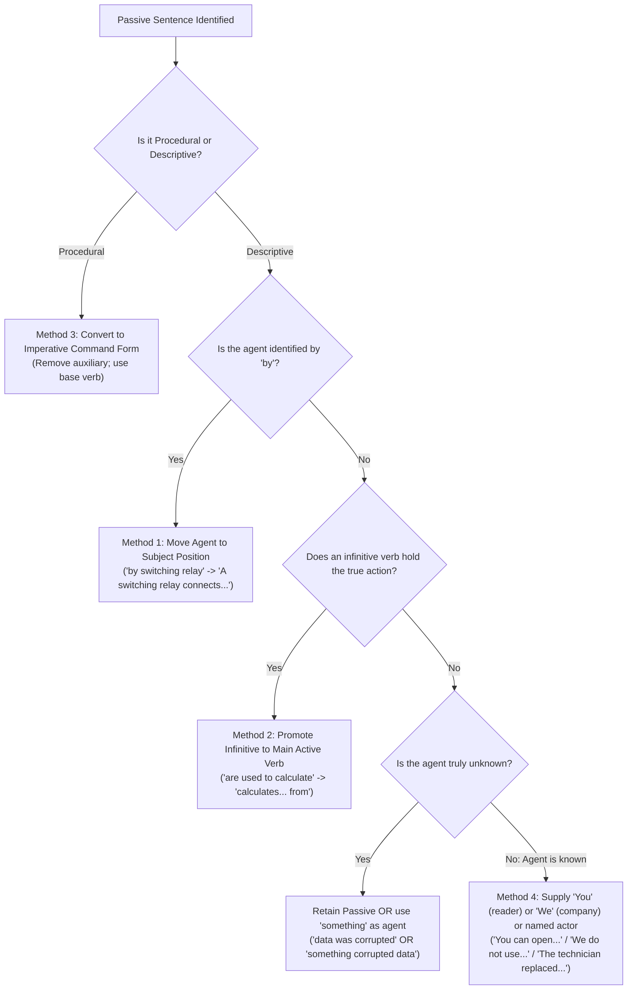

# Section 3: Verbs (Rules 3.1 – 3.7)

> **Rule Specification**: ASD-STE100 Issue 9, Part 1 – Writing Rules, Section 3: Verbs (Rules 3.1 through 3.7).

---

## Executive Summary & Verb Philosophy in STE

Verbs are the operational engine of technical communication. Standard English offers an enormous array of verb tenses, aspects, moods, and voices—spanning simple, perfect, continuous, conditional, and subjunctive constructions. In technical maintenance and operational environments, this grammatical complexity is a major cause of procedural confusion.

ASD-STE100 enforces a rigorous verb discipline centered on three core principles:
1. **Radical Tense Simplification**: Only **6 specific forms/tenses** are permitted. All perfect and progressive (continuous) aspectual structures are strictly prohibited.
2. **Universal Active Voice Preference**: Imperative commands dominate procedures; active agent-driven clauses dominate descriptive texts, with a tightly defined exception for strictly unknown agents.
3. **De-nominalization**: Actions must be expressed as direct verbs rather than buried in abstract nouns, except when the action verb is not approved in the dictionary.

---

## Rule 3.1: Form and Use of Verbs

> **Rule Statement**:  
> **Use only the verb forms that are given in the dictionary.**

### Rationale & Morphological Control
In standard English, irregular verbs exhibit diverse morphological variations, and writers frequently invent non-standard participles or colloquial conjugations. STE restricts verb morphology to the forms explicitly listed in the dictionary (see [dictionary/index.md](dictionary/index.md)).

### The Four Verb Classes in the STE Dictionary

```
STE VERB CLASSIFICATIONS (Part 2)
├── 1. Regular Verbs
│   └── Adds "-ed" to base form for simple past and past participle:
│       ADAPT (v), ADAPTS, ADAPTED, ADAPTED
├── 2. Irregular Verbs
│   └── Non-standard inflections explicitly listed:
│       GIVE (v), GIVES, GAVE, GIVEN
├── 3. Irregular Auxiliary Verbs
│   └── Severely restricted auxiliary paradigms:
│       BE (v), IS, WAS (also ARE, WERE). No other verb forms permitted.
└── 4. Defective Modal Verbs
    └── Incomplete paradigms with restricted semantics:
        CAN (v), CAN, COULD. (Note: COULD restricted; see Rule 3.4)
        WILL (v). No other verb forms permitted.
```

### The "Absent Form Equals Prohibited Form" Principle
If a verb form does not appear in the four-part entry in the dictionary, **it does not exist in STE**:
- For `REMOVE (v)`:
  - Form 1: `(To) remove` / `remove` (Infinitive / Imperative)
  - Form 2: `removes` (3rd person singular present)
  - Form 3: `removed` (Simple past)
  - Form 4: `removed` (Past participle—**adjective only**)
- Forms such as *removing* (as a progressive verb), *having removed*, or *removeth* are completely prohibited.

---

## Rule 3.2: Permitted Verb Tenses and Forms

> **Rule Statement**:  
> **Use only these verb forms and tenses of verbs:**  
> - **The infinitive form**  
> - **The imperative form (command form)**  
> - **The simple present tense**  
> - **The simple past tense**  
> - **The simple future tense**  
> - **The past participle form (as an adjective).**

### The 6 Permitted Verb Manifestations

| Permitted Form / Tense | Regular Example (`ADJUST`) | Irregular Example (`GIVE`) | Syntactic Context & Function |
| :--- | :--- | :--- | :--- |
| **1. Infinitive Form** | `(to) adjust` | `(to) give` | Expressing purpose or following modal auxiliaries: `It is necessary to adjust...` |
| **2. Imperative Form** | `Adjust the linkage.` | `Give the information.` | Direct procedural command addressing the technician directly. |
| **3. Simple Present Tense** | `You/we/they adjust`<br>`It adjusts` | `You/we/they give`<br>`It gives` | Operational descriptions, physical laws, recurrent states. |
| **4. Simple Past Tense** | `You/we/they adjusted`<br>`It adjusted` | `You/we/they gave`<br>`It gave` | Completed historical events, incident reporting, test logs. |
| **5. Simple Future Tense** | `You/we/they will adjust`<br>`It will adjust` | `You/we/they will give`<br>`It will give` | Future results, system responses: `The valve will close.` |
| **6. Past Participle (Adjective)** | `the adjusted linkage` | `the given information` | **Condition/state modifier only**. Never a compound verb. |

---

### Excluded Tenses & Linguistic Rationale

```
PROHIBITED VERB STRUCTURES IN STE
├── Present Perfect  (have/has adjusted, have given)   --> Ambiguous temporal anchor
├── Past Perfect     (had adjusted, had given)        --> Unnecessary chronological layering
├── Progressive      (is adjusting, was giving)       --> Fuzzy temporal boundary
├── Future Perfect   (will have adjusted)             --> Extreme cognitive complexity
└── Conditional      (would/could/should adjust)      --> Speculative ambiguity
```

#### Why Perfect Aspect is Prohibited
In standard English, the present perfect (*"The operator has adjusted the valve"*) indicates a past action with current relevance. However, non-native English speakers consistently struggle to differentiate between simple past and present perfect. Furthermore, in automated translation, perfect tenses generate severe syntactic alignment errors. In STE, an action either occurred in the past (`The operator adjusted the valve`) or describes a current state (`The valve is adjusted`).

#### Why Continuous/Progressive Aspect is Prohibited
Continuous forms (*"The pump is vibrating"*) introduce temporal fuzziness: Is the vibration continuous, intermittent, or transient? STE insists on the simple present: `The pump vibrates.`

---

## Rule 3.3: Past Participle Used as an Adjective

> **Rule Statement**:  
> **Use the past participle form as an adjective.**

### State vs. Passive Action
In STE, the past participle form is **not a verb tense**. It functions solely as an **adjective** that denotes the physical condition or operational status of an object.

```
PAST PARTICIPLE SYNTACTIC POSITIONS
├── Attributive (Before a Noun)
│   └── "Examine all parts of the disassembled unit for damage."
│       ("disassembled" describes the state of the unit).
└── Predicative (After Linking Verbs: BE, BECOME, STAY)
    └── "When the unit is fully disassembled, clean all the parts."
        ("is disassembled" denotes the static condition resulting from the action).
```

### Distinguishing Passive Voice from Adjectival State
Writers often confuse the predicative adjective with passive voice because both follow the auxiliary verb `BE`:
- **Passive Voice (Action performed by an agent)**:  
  *The unit is disassembled by the technician.* $\rightarrow$ Non-STE. (Change to: `The technician disassembles the unit.`)
- **Adjectival Condition (Static state)**:  
  `THE UNIT IS DISASSEMBLED.` $\rightarrow$ Approved STE if it answers *"What state is the unit in?"* rather than *"What action is currently being executed?"*

### Approved Adjectives Derived from Non-Approved Verbs
The STE dictionary contains several approved adjectives that are grammatically past participles of verbs that are **not** approved in STE:
- `DAMAGED (adj)`: Derived from unapproved verb *damage*. Valid: `MAKE SURE THAT THE MATING SURFACES ARE NOT DAMAGED.`
- `PERMITTED (adj)`: Derived from unapproved verb *permit*. Valid: `DO NOT PUT MORE THAN THE PERMITTED WEIGHT ON THE TROLLEY.`

---

## Rule 3.4: Elimination of Complex Auxiliary Verbs

> **Rule Statement**:  
> **Do not use auxiliary verbs to make complex verb constructions.**

### Rationale & Auxiliary Stacking
Standard technical writing is saturated with bureaucratic, passive modal auxiliary chains (*"is to be installed"*, *"can be adjusted"*, *"must be examined"*, *"will have been calibrated"*). These strings obscure the actor, dilute responsibility, and confuse the reader.

### Transformation Protocols for Complex Auxiliaries

#### Protocol 1: Eliminate "HAVE" + Past Participle (Compound Perfects)
- *Non-STE*: *The operator has adjusted the linkage.*
- **STE**: `THE OPERATOR ADJUSTED THE LINKAGE.`

#### Protocol 2: Eliminate "IS TO BE" Constructions
- *Non-STE*: *The seat is to be installed before you install the cushion.*
- **STE (Procedural)**: `BEFORE YOU INSTALL THE CUSHION, INSTALL THE SEAT.`
- **STE (Descriptive)**: `BEFORE YOU INSTALL THE CUSHION, THE OPERATOR MUST INSTALL THE SEAT.`

#### Protocol 3: Eliminate Passive Modal Chains ("CAN BE / MUST BE / WILL BE")
- *Non-STE*: *The volume control can be adjusted.*
- **STE (Procedural)**: `ADJUST THE VOLUME CONTROL.`
- **STE (Descriptive)**: `YOU CAN ADJUST THE VOLUME CONTROL.`

- *Non-STE*: *The temperature must be adjusted before the start of the test.*
- **STE (Procedural)**: `BEFORE YOU START THE TEST, ADJUST THE TEMPERATURE.`
- **STE (Descriptive)**: `BEFORE THE START OF THE TEST, THE OPERATOR MUST ADJUST THE OIL TEMPERATURE.`

- *Non-STE*: *The sleeve will be adjusted by the robot.*
- **STE**: `THE ROBOT WILL ADJUST THE SLEEVE.`

---

### The STE Modal Auxiliary Matrix

| Modal Auxiliary | Approved Status | Permitted Meanings & Constraints | Prohibited Uses |
| :--- | :--- :--- | :--- | :--- |
| **`CAN`** | **APPROVED** | 1. Physical ability (`YOU CAN CLEAN THE DRAIN HOLES...`)<br>2. Logical possibility (`FUEL AND OXYGEN CAN CAUSE AN EXPLOSION`)<br>3. Permission (`YOU CAN OPERATE THE VEHICLE AFTER...`) | Do not substitute with *may* or *might*. |
| **`WILL`** | **APPROVED** | Simple future tense only (`THIS WILL HELP YOU...`). | Do not use for habitual present or polite requests. |
| **`MUST`** | **APPROVED** | Absolute necessity or regulatory obligation. | Do not use for logical deductions (*"It must be broken"*). |
| *COULD* | *RESTRICTED* | Past ability only. | **PROHIBITED for possibility** (*"An explosion could occur"* $\rightarrow$ `CAN OCCUR`). |
| *MAY* | *UNAPPROVED* | Not approved in dictionary. | Replace with `CAN` for possibility/permission. |
| *MIGHT* | *UNAPPROVED* | Not approved in dictionary. | Replace with `CAN`. |
| *SHOULD* | *UNAPPROVED* | Not approved in dictionary (creates ambiguous recommendations). | Replace with `MUST` (if mandatory) or `RECOMMEND` / imperative. |
| *WOULD* | *UNAPPROVED* | Not approved in dictionary. | Rephrase with `WILL` or conditional clause. |

---

## Rule 3.5: Forms Ending in "-ing"

> **Rule Statement**:  
> **Use the "-ing" form of a verb only as a technical noun or as a modifier in a technical noun.**

### The Linguistic Hazard of "-ing"
In standard English, the `-ing` suffix creates at least four distinct syntactic forms:
1. **Present participle in progressive verbs**: *The door is opening.*
2. **Participial adjectives**: *An opening door can be dangerous.*
3. **Gerund nouns**: *Opening a door requires caution.*
4. **Participial clause connectors**: *Mechanics opening doors without safety gear...*

This multifunctionality breeds monstrous, dangling, uncontrolled sentences.

---

### The Anatomy of an "-ing" Catastrophe

Consider this classic unapproved complex example:

> *Non-STE (72 words, completely unreadable)*:  
> *Mechanics wearing insufficient protective clothing and opening containers containing hazardous materials in areas where there is a lack of ventilation, using inappropriate tools without observing the manufacturer's instructions, are in danger of coming into contact with these materials and thus suffering from skin irritation and breathing problems.*

#### STE Systematic Deconstruction:
STE disassembles this run-on participial monstrosity into structured, sequential, numbered procedural commands followed by an active consequence:

```
STE CONVERSION:
BEFORE YOU USE DANGEROUS MATERIALS, OBEY THESE PRECAUTIONS:
(1) READ THE MANUFACTURER'S INSTRUCTIONS.
(2) MAKE SURE THAT THERE IS SUFFICIENT AIRFLOW IN THE WORK AREA.
(3) PUT ON A FACE MASK AND PROTECTIVE CLOTHING.
(4) GET THE CORRECT TOOLS TO OPEN THE CONTAINERS FOR THESE MATERIALS.
IF YOU DO NOT OBEY THESE PRECAUTIONS, INJURY TO YOUR SKIN AND YOUR LUNGS CAN OCCUR.
```

---

### The Three Permitted Classes of "-ing" Words

```
PERMITTED "-ING" CONSTRUCTIONS IN STE
├── 1. Explicitly Approved Dictionary Entries
│   ├── Nouns:       lighting, opening, routing, servicing
│   ├── Adjectives:  mating, missing, remaining
│   ├── Pronoun:     something
│   └── Preposition: during
├── 2. Technical Nouns in Procedural Headings / Titles
│   └── Cleaning, Testing and Fault Isolation, Handling, Packaging, Shipping, Troubleshooting
└── 3. Functional Technical Modifiers (Adjectives in Technical Nouns)
    └── air-conditioning system, degreasing agent, grinding wheel, polishing disc,
        sanding machine, switching relay, welding torch
```

---

## Rule 3.6: Active Voice vs. Passive Voice

> **Rule Statement**:  
> **Use the active voice. In descriptive writing, you can use the passive voice only when the agent is unknown.**

### Core Definitions
- **Active Voice**: The grammatical subject is the actor (agent) who performs the action:  
  $$\text{Subject (Agent)} \longrightarrow \text{Verb (Action)} \longrightarrow \text{Object (Target)}$$  
  `THE SIDE STAY HOLDS THE MAIN GEAR LEG.`
- **Passive Voice**: The grammatical subject is the receiver of the action:  
  $$\text{Subject (Target)} \longleftarrow \text{Passive Verb} \longleftarrow \text{by Agent}$$  
  *The main gear leg is held by the side stay.*

---

### The "By Whom or By What?" Passive Diagnostic
To identify passive voice in any sentence, ask: **"By whom or by what is this action executed?"**
1. If the sentence explicitly states the answer (often marked by the preposition `by`), the object of `by` is the true agent. Move it to the subject position.
2. If the sentence does *not* state the agent, determine whether the agent is truly unknown, or simply unstated because the author was lazy.

---

### The Critical "Unknown-Agent" Exception in Descriptive Writing

> [!IMPORTANT]
> ASD-STE100 permits the passive voice in **descriptive writing ONLY when the agent is genuinely unknown**. It is **strictly prohibited in procedural writing**.

#### Strictly Unknown Agent vs. "Known-but-Irrelevant"
Technical authors often attempt to justify the passive voice by arguing that the agent is "obvious", "unimportant", or "known-but-irrelevant" (e.g., claiming that everyone knows a technician performs the work).

**ASD-STE100 strictly rejects the "known-but-irrelevant" rationale.**
- If the agent is known—even if obvious, mundane, or backgrounded (such as the technician, the operator, the ground crew, the computer, or the manufacturer)—you **must** write the sentence in the active voice.
- Passive voice is permitted **exclusively** when the agent is genuinely unknown or cannot be identified.

#### Comparison of Agent Scenarios

| Scenario | Agent Knowledge | Compliant Voice | Non-STE Passive Attempt | Approved STE Active Construction |
| :--- | :--- | :--- | :--- | :--- |
| Known actor (technician) | Known | **Active** | *The oil filter was replaced.* | `THE TECHNICIAN REPLACED THE OIL FILTER.` |
| Known component action | Known | **Active** | *The circuits are connected by a relay.* | `A SWITCHING RELAY CONNECTS THE CIRCUITS.` |
| Known general practice | Known | **Active** | *Additives are not used in this fuel.* | `WE DO NOT USE ADDITIVES IN THIS FUEL.` |
| Genuine mystery / unknown cause | **Strictly Unknown** | **Passive Permitted** | — | `DURING TRANSMISSION, THE DATA WAS CORRUPTED.` |

#### The Data Corruption Paradigm
- **Passive (Compliant when agent is strictly unknown)**:  
  `DURING TRANSMISSION, THE DATA WAS CORRUPTED.`  
  *(Analysis: We do not know what corrupted the data—radiation, hardware failure, power dip).*
- **Active Alternative with "Something" (Compliant)**:  
  `DURING TRANSMISSION, SOMETHING CORRUPTED THE DATA.`  
  *(Analysis: `something` is an approved STE pronoun used as the indefinite agent).*
- **The False Agent Danger (*Technically Incorrect*)**:  
  *Non-STE*: *Transmission corrupted the data.*  
  *(Analysis: This is technically FALSE. "Transmission" is the process of data travel, not the agent causing corruption! Never invent an inaccurate agent just to force active voice).*

---

### Four Systematic Methods to Convert Passive into Active



#### Method 1: Invert Agent to Subject Position
- *Non-STE (Passive)*: *The circuits are connected by a switching relay.*
- **STE (Active)**: `A SWITCHING RELAY CONNECTS THE CIRCUITS.`

#### Method 2: Promote the Embedded Infinitive
- *Non-STE (Passive)*: *These values are used by the computer to calculate the energy consumption.*
- **STE (Active)**: `THE COMPUTER CALCULATES THE ENERGY CONSUMPTION FROM THESE VALUES.`

#### Method 3: Convert Procedural Sentences to Imperative Commands
- *Non-STE (Passive)*: *The test can be continued by the operator.*
- **STE (Imperative)**: `CONTINUE THE TEST.`
- *Non-STE (Passive)*: *Oil and grease are to be removed with a degreasing agent.*
- **STE (Imperative)**: `REMOVE OIL AND GREASE WITH A DEGREASING AGENT.`

#### Method 4: Supply "YOU" (Reader) or "WE" (Organization)
- *Non-STE (Passive)*: *On the ground, the valve can be opened with the override handle.*
- **STE (Active with "You")**: `ON THE GROUND, YOU CAN OPEN THE VALVE WITH THE OVERRIDE HANDLE.`
- *Non-STE (Passive)*: *Additives are not used in this type of fuel.*
- **STE (Active with "We")**: `WE DO NOT USE ADDITIVES IN THIS TYPE OF FUEL.`
- **STE (Alternative Active)**: `THIS TYPE OF FUEL DOES NOT CONTAIN ADDITIVES.`

---

## Rule 3.7: Express Actions as Verbs (Anti-Nominalization)

> **Rule Statement**:  
> **Use an approved verb to describe an action, not a noun or other parts of speech.**

### Rationale & Nominalization Breakdown
Nominalization (smothered verbs) occurs when an action is converted into a noun (e.g., *give an indication of*, *perform the removal of*, *conduct an investigation of*). Nominalizations inflate word count, bury the operative action, and weaken clause clarity.

### Examples of De-nominalization

| Nominalized Construction (*Non-STE*) | Active STE Verb Construction | Operative Action |
| :--- | :--- | :--- |
| *The ohmmeter gives an indication of 450 ohms.* | `THE OHMMETER SHOWS 450 OHMS.` | `SHOW` directly describes output. |
| *Before the removal of the unit...* | `BEFORE YOU REMOVE THE UNIT...` | `REMOVE` directly describes the action. |
| *Do the installation of the seals.* | `INSTALL THE SEALS.` | `INSTALL` replaces nominal phrase. |
| *Accomplish the calibration.* | `CALIBRATE THE UNIT.` | `CALIBRATE` replaces hollow auxiliary. |

---

### The Critical Exception: Unapproved English Verbs

> [!CAUTION]
> If a standard English action verb is **NOT approved in the STE dictionary**, you are **strictly forbidden** from using it as a verb. You must use the approved nominal construction or an approved alternative verb!

#### The "Check" and "Test" Paradigms
- **`CHECK` is not approved as a verb in STE** (it is approved only as a noun `(n)`, see [dictionary/c.md#check](dictionary/c.md#check)).
  - *Non-STE*: *Check the laptop battery.*
  - **STE**: `DO A CHECK OF THE LAPTOP BATTERY.` or `EXAMINE THE LAPTOP BATTERY.`
- **`TEST` is not approved as a verb in STE** (it is approved only as a noun `(n)`, see [dictionary/t.md#test](dictionary/t.md#test)).
  - *Non-STE*: *Test the system for leaks.*
  - **STE**: `DO A TEST FOR LEAKS IN THE SYSTEM.` or `DO THE LEAK TEST OF THE SYSTEM.`

---

## Verb Transformation Decision Table

| Encountered Non-STE Construction | Core Flaw | Rule Violated | Standard STE Resolution |
| :--- | :--- | :---: | :--- |
| *The technicians have completed the task.* | Present perfect aspect | 3.2, 3.4 | `THE TECHNICIANS COMPLETED THE TASK.` |
| *The fuel is flowing into the manifold.* | Progressive / continuous aspect | 3.2, 3.5 | `THE FUEL FLOWS INTO THE MANIFOLD.` |
| *The valve can be opened by the crew.* | Passive modal auxiliary | 3.4, 3.6 | `THE CREW CAN OPEN THE VALVE.` |
| *Upon completion of the disassembly...* | Nominalized prepositional phrase | 3.7 | `AFTER YOU DISASSEMBLE THE UNIT...` |
| *The technician could cause an explosion.* | Unapproved modal *could* | 3.4 | `THE TECHNICIAN CAN CAUSE AN EXPLOSION.` |
| *Make sure of the alignment of the rod.* | Nominalized action | 3.7 | `MAKE SURE THAT THE ROD ALIGNS.` |
| *Test the circuit breaker.* | Unapproved verb *test* | 1.2, 3.7 | `DO A TEST OF THE CIRCUIT BREAKER.` |
| *Check the torque on the bolts.* | Unapproved verb *check* | 1.2, 3.7 | `DO A CHECK OF THE TORQUE ON THE BOLTS.` |

---

## Cross-Reference Matrix

- **[words.md](words.md)**: Rule 1.2 (Parts of Speech), Rule 1.4 (Forms of Verbs), Rule 1.12 (Technical Verbs).
- **[sentences.md](sentences.md)**: Rule 4.1 (Short and Clear Sentences), Rule 4.2 (No Omitted Words/Contractions).
- **[terminology.md](terminology.md)**: TV-01 through TV-04 (Complete Technical Verb Taxonomies).
- **[dictionary/index.md](dictionary/index.md)**: Master lexical index for verb conjugations and approved parts of speech.
